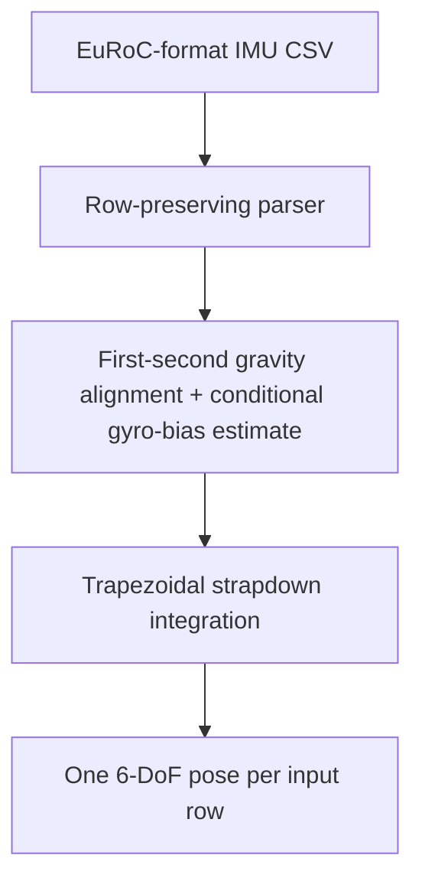

<div align="center">


<br>

<a href="https://research.samsung.com/"></a>
&nbsp;&nbsp;&nbsp;&nbsp;&nbsp;
<a href="https://www.samsungprism.com/"></a>

<p><strong>Samsung PRISM XR Hackathon Challenge 2026 · Track 3: Path Finder</strong></p>
<p>IMU-only, 6-DoF trajectory estimation under sensor degradation.</p>

[Challenge](#the-challenge) · [Architecture](#architecture) · [Measured results](#measured-results) · [Run](#run-vortex) · [Research notes](#research-notes)

</div>

---

## The challenge

An aircraft must navigate without GPS or cameras while its IMU becomes less reliable: noise and bias grow, readings disappear for up to two seconds, and the sensor eventually fails. The task is to reconstruct a **6-DoF pose for every input IMU row**, including the five seconds after failure, from a EuRoC-format `imu0/data.csv` alone. The evaluator uses EuRoC MAV and TUM-VI sequences with hidden ground truth.

| Input → output | Operating limits | Evaluation |
|---|---|---|
| Gyroscope + accelerometer → `timestamp tx ty tz qx qy qz qw`; one pose per input row, in order | Offline, one thread; **8 MB peak RAM** and **20 ms compute per second of IMU** | 60 points for trajectory (waypoints 30, blind prediction 20, dropouts 10); 40 for efficiency |

Small attitude and bias errors grow rapidly under inertial integration. Vortex's research direction is to infer conditional **velocity witnesses** from the same IMU and adjust their influence as sensor quality changes. The scored path uses no camera, GPS, barometer, ground truth, or pretrained model.

## Architecture

**Implemented in the submission entry point today:**



`main.py` is a standalone, standard-library estimator. It estimates initial orientation from average acceleration over the first second, estimates gyro bias only when that window appears still, then integrates orientation, velocity, and position. Invalid samples and timestamp gaps coast with constant velocity while preserving the output row contract. The independently readable [reference integrator](vortex/core/strapdown.py) and the optimized entry point agree exactly on recorded synthetic equivalence cases.

**Next estimator stages:** detect stillness anywhere in the healthy phase or initialize while moving; track bias, sensor quality, and dropouts; fuse validated velocity witnesses; bridge missing samples and forecast the final five seconds. These stages are design goals, **not current `main.py` capabilities**. See the [implementation plan](Docs/TRACK3_PLAN.md).

| Velocity cue under study | Purpose | Current decision |
|---|---|---|
| Stillness and learned flight envelope | Bound drift using zero-velocity intervals and plausible flight speeds | Planned for adaptive fusion |
| Rotor drag | Infer body-frame velocity from multirotor acceleration | **Off:** pre-registered whole-sequence rule returned NO-GO on MH_01–05 |
| Turn physics, walking rhythm, tilt response | Conditional cues for specific motion and platforms | Exploratory; require held-out gains and budget checks |

After-rest rotor-drag fits are promising but **post hoc**; they do not reverse the registered NO-GO decision. The protocol, negative result, and plots are in the [drag study](Docs/DRAG.md).

## Measured results

| Check | Recorded outcome | Scope |
|---|---|---|
| Real EuRoC `MH_01_easy` output contract | **PASS:** 36,820 input rows → 36,820 poses | Windows, Python 3.14; [checker](vortex/check_output.py) |
| Real `MH_01_easy` efficiency | **1.27 ms / IMU-second**, 6.36 µs / row; 11.66 MB peak process RSS | [Budget ledger](Docs/BUDGET.md); compute is within the 20 ms limit |
| Reference vs optimized integrator | Exact agreement on recorded messy, random, degraded, and physical synthetic trajectories | [Equivalence tests](tests/test_core_equivalence.py) |
| Automated suite | **136 passing tests** in the latest recorded Windows/Python 3.14 run | [Project plan](Docs/TRACK3_PLAN.md); includes 5 drag tests |
| Synthetic scorer cross-check | Worst reported difference **4.2 × 10⁻⁷ m** against independently installed evo | [Numerical ledger](Docs/EVO_CROSSCHECK.md); synthetic trajectories |

**Accuracy is the open problem.** EuRoC MH_01 begins while hand-carried, so the current first-second stillness assumption fails. The full-sequence, uncorrected dead-reckoning run has **51,304 m SE(3) ATE** and 118 km final position error; it is a diagnostic floor, not a competitive navigation result. From a later ground-rest window at 25 s, an offline segment check reached 0.25 m end error after 10 s and 6.6 m after 30 s **with yaw and origin fitted**. That local diagnostic does not describe full-sequence performance. See the [real-data record](Docs/TRACK3_PLAN.md) and [segment diagnostic](tools/integrator_check.py).

The **8 MB whole-process RAM limit is not yet met** on the measured machines: even interpreter startup exceeds it. The evaluator's accounting definition remains open. Real S24 operation and TUM-VI accuracy are also unverified.

## Run Vortex

Python 3.10+; the submission entry point itself uses only the standard library. Analysis and test tools use `pyproject.toml` dependencies.

```bash
python -m pip install -e '.[dev]'
pytest

# Format and output-contract smoke test; this is synthetic, not a flight.
python tools/synth_euroc.py imu.csv --rows 36000 --seed 0
python -S main.py imu.csv estimated_trajectory.txt
python -m vortex.check_output imu.csv estimated_trajectory.txt
```

The checker should report `PASS: 36000 input rows, 36000 output rows`. The synthetic file exercises parsing and output; it does not establish navigation accuracy.

For a local EuRoC sequence, put `MH_01_easy` under the ignored `data/euroc/` directory ([data setup](Docs/DATA.md)). The data is not committed:

```bash
python -S main.py data/euroc/MH_01_easy/mav0/imu0/data.csv estimated_trajectory.txt
python -m vortex.check_output data/euroc/MH_01_easy/mav0/imu0/data.csv estimated_trajectory.txt
python score.py --gt data/euroc/MH_01_easy --est estimated_trajectory.txt
```

To create a reproducible degraded sequence and score separate healthy, degraded, dropout, and blind windows, use the [fault injector](vortex/degrade.py) and [scorer](vortex/scoring.py):

```bash
python -m vortex.degrade data/euroc/MH_01_easy out/MH_01_s1 --seed 1
python -S main.py out/MH_01_s1/mav0/imu0/data.csv out/MH_01_s1/estimated_trajectory.txt
python -m vortex.check_output out/MH_01_s1/mav0/imu0/data.csv out/MH_01_s1/estimated_trajectory.txt
python score.py --gt data/euroc/MH_01_easy --est out/MH_01_s1/estimated_trajectory.txt --events out/MH_01_s1/degrade.json
```

This is a reproducible evaluation workflow, not a claim that the current estimator is robust to the injected faults.

## Research notes

- [Track 3 plan](Docs/TRACK3_PLAN.md) — current stage, real-sequence diagnostics, design, and acceptance criteria.
- [Budget ledger](Docs/BUDGET.md) and [efficiency floor](Docs/FLOOR.md) — synthetic and real timing, memory, and interpreter cost.
- [Rotor-drag study](Docs/DRAG.md) — pre-registered NO-GO result and explicitly labeled exploratory fits.
- [Scorer cross-check](Docs/EVO_CROSSCHECK.md) — evo comparison on synthetic trajectories.
- [Data instructions](Docs/DATA.md) and [third-party notices](THIRD_PARTY.md) — datasets stay outside the repository.

**Team:** Arnav Jain (lead), Arya M, Nandhitha Chowdary Surapaneni. This is a team submission to the Samsung PRISM XR Hackathon Challenge 2026. Samsung Research and Samsung PRISM marks identify the challenge context; Vortex is the team's project.

<sub>Project code: [MIT](LICENSE). Brand marks are Samsung's; [Research mark](https://cdn.codeground.org/nsr/images/layout/logo-sr.png) and [PRISM mark](https://www.samsungprism.com/assets/images/prism_logo.png) are reproduced from their official sites.</sub>
