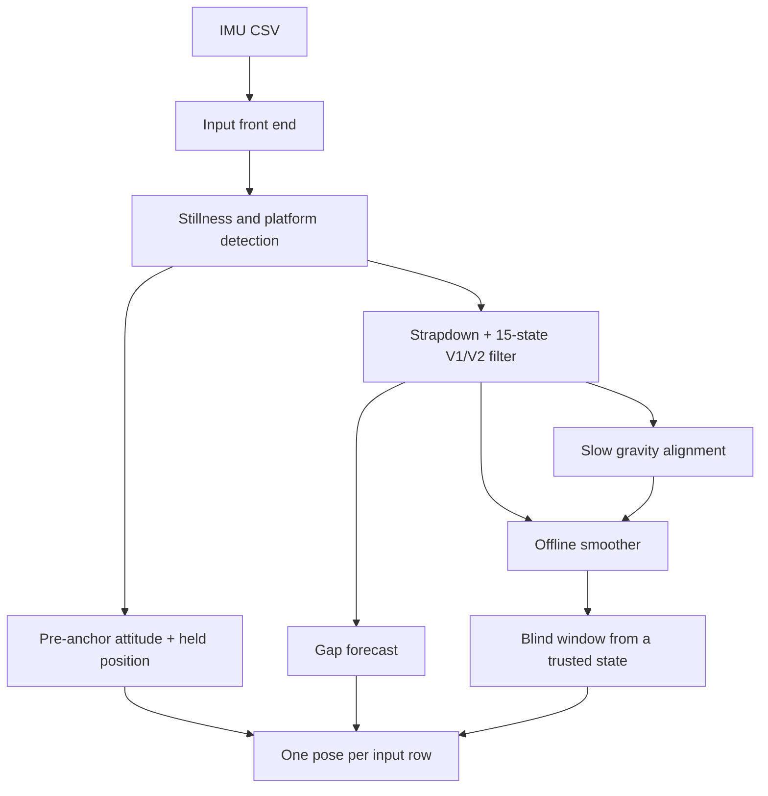

<div align="center">


<br>

<a href="https://research.samsung.com/"></a>
&nbsp;&nbsp;&nbsp;&nbsp;&nbsp;
<a href="https://www.samsungprism.com/"></a>

<p><strong>Samsung PRISM XR Hackathon Challenge 2026 · Track 3: Path Finder</strong></p>
<p>IMU-only, 6-DoF trajectory estimation under sensor degradation.</p>

[Challenge](#the-challenge) · [Architecture](#architecture) · [Comparisons](#where-vortex-is-better) · [Measured results](#measured-results) · [Run](#run-vortex) · [Research notes](#research-notes)

</div>

---

> **Official-script held-out result (shipped v1.0 build):** On 36 EuRoC copies (six sequences, two column readings, seeds 4–6), Vortex records **3.440 m** mean SE(3)-aligned APE versus **3.745 m** for a never-moving trajectory: **8.1% lower**. Reading **a** is **3.506 vs 3.745 m**, reading **b** **3.373 vs 3.745 m**. In the blind five seconds Vortex **ties** the floor: **2.494 vs 2.504 m** (0.4% lower). These are results on these held-out copies, not a guarantee on hidden data. [Verified figures](Docs/NUMBERS.md) · [results](Docs/RESULTS.md) · [decision log](Docs/TRACK3_PLAN.md).

## The challenge

An aircraft must navigate without GPS or cameras while its IMU becomes less reliable: noise and bias grow, readings disappear for up to two seconds, and the sensor eventually fails. The task is to reconstruct a **6-DoF pose for every input IMU row**, including the five seconds after failure, from a EuRoC-format `imu0/data.csv` alone. The evaluator uses EuRoC MAV and TUM-VI sequences with hidden ground truth.

| Input → output | Operating limits | Evaluation |
|---|---|---|
| Gyroscope + accelerometer → `timestamp tx ty tz qx qy qz qw`; one pose per input row, in order, never appended | Python only; offline (batch smoothing allowed), one thread; **8 MB peak at heap level** and **20 ms compute per second of IMU** | SE(3)-aligned ATE (evo) against hidden ground truth: 60 points for trajectory (waypoints 30, blind prediction 20, dropouts 10); 40 for efficiency (memory 20, runtime 20) |

The organisers' FAQ (17 Nov 2026) settled the open points: Python only (`main.py`; `main.cpp` is not accepted), the 8 MB limit is measured at algorithm / heap level rather than process RSS, non-causal smoothing is allowed, scoring uses SE(3) Umeyama alignment, dropouts are physically missing rows, and test data is any EuRoC or TUM-VI sequence degraded with their `degrade_imu.py`.

Small attitude and bias errors grow rapidly under inertial integration. Vortex uses IMU-only cues: **V1 stillness**, **V2 speed and running-centre priors**, a platform-specific envelope for hand-held TUM-VI input, and slow gravity alignment when gyro noise is high. V2 bounds drift but is a prior, **not an independent motion measurement**. No camera, GPS, barometer, ground truth or pretrained model enters the estimator.

## Architecture

**Shipped Python path:**



The estimator is [`pathfinder.py`](pathfinder.py), standard library only; in the repository `main.py` is a stub that runs it, and the submission ships it as one generated, self-contained `src/main.py` ([Run Vortex](#run-vortex)). The **input front end** detects IMU column order, timestamp scale and acceleration units from the file; degrees/second versus fast radians/second motion cannot always be resolved automatically. The estimator calibrates gravity, tilt and gyro bias on a still interval (or falls back), holds pre-anchor position, and runs a 15-state error-state Kalman filter. A whole-file accelerometer statistic selects the drone or hand-held envelope. Missing rows increase uncertainty; exact zero/stuck failures and invalid samples trigger a 0.5 s velocity-decay forecast. A gyro noise meter activates windowed gravity alignment when needed. Step F caps gyro bias, widens fallback velocity uncertainty and refreshes cached samples; the offline smoother revises earlier poses from later IMU samples. **Blind window (Step L3):** if the file ends in a run of rows rejected as dead (all-zero or stuck) lasting at least 1 s, every pose from 3 s before that run to the end keeps the attitude of the last trusted pose, and its position is pulled toward the centroid of the trajectory so far, the pull ramping up over those 3 s. This is a trust policy, not a forecast of the motion; a file without such a run is left unchanged.

| IMU-only cue | Role | Shipped state |
|---|---|---|
| V1 · Stillness | Zero-velocity and gyro-bias updates | **On**; little in-flight rest on MH, no detected stillness on the measured TUM-VI rooms |
| V2 · Flight / hand-held envelope | Speed and running-centre position priors selected by platform | **On**; bounds drift but can flatten real motion |
| Slow gravity alignment | Windowed correction when gyro noise rises | **On**; Step L2 passed its revised rule on held-out copies |
| V3 · Rotor drag | Proposed in-flight velocity cue | **Not built**; both registered signal rules returned NO-GO |
| Turn physics, walking rhythm | Conditional research ideas | Not shipped |

The [reference filter](vortex/core/witness.py) retains rejected experiments. Presence in source does not mean a feature is enabled.

### Switches

Every `*_ON` assignment in the shipped [`pathfinder.py`](pathfinder.py) on the current main branch is **on**. Rejected alternatives live in the reference or lab copy, not in this switch list:

| Switch | State | Reason and record |
|---|---|---|
| `FRONT_ON` | **On** | Input format detection; [Step 2](Docs/TRACK3_PLAN.md). |
| `CAL_NOISE_ON` | **On** | Noise-tolerant still calibration fallback; [Step 6e](Docs/TRACK3_PLAN.md). |
| `BGCAP_ON` | **On** | Caps false stillness during steady rotation; [Step F](Docs/TRACK3_PLAN.md). |
| `P0V_ON` | **On** | Wider initial velocity uncertainty without an anchor; [Step F](Docs/TRACK3_PLAN.md). |
| `REFRESH_ON` | **On** | Refreshes cached sample after correction; [Step F](Docs/TRACK3_PLAN.md). |
| `SMOOTH_ON` | **On** | Offline forward-backward correction passed the registered held-out rule; [Step 6](Docs/TRACK3_PLAN.md). |
| `PLATFORM_ON` | **On** | Detects hand-held versus multirotor input and selects the envelope; [Step 7](Docs/TRACK3_PLAN.md). |
| `TILT_ON` | **On** | Noisy-gyro gravity alignment passed revised rule G2; the rule was changed after G failed, so evidence is weaker. [Step L2](Docs/TRACK3_PLAN.md). |
| `TILT_LAG` | **On** | Lag model of that gravity alignment; part of the Step L2 build judged by rule G2. [Step L2](Docs/TRACK3_PLAN.md). |
| `BLIND_ON` | **On** | Blind window from a trusted state; passed rule H' after rule H failed, so evidence is weaker. [Step L3](Docs/TRACK3_PLAN.md). |
| `BLIND_DEAD_ONLY` | **On** | Acts only on a detected trailing dead run, never on a fixed last 5 s (rule H's fallback, which failed on clean TUM-VI). [Step L3](Docs/TRACK3_PLAN.md). |
| `V1_ON` | **On** | Stillness witness; [Step 7a](Docs/TRACK3_PLAN.md). |
| `V2_ON` | **On** | Speed prior; [Step 7a](Docs/TRACK3_PLAN.md). |
| `V2P_ON` | **On** | Running-centre position prior; [Step 7a](Docs/TRACK3_PLAN.md). |
| `GAP_ON` | **On** | Dropout covariance; [Step 6c](Docs/TRACK3_PLAN.md). |
| `DEAD_ON` | **On** | Exact zero/stuck failure detection; [Step 8a](Docs/TRACK3_PLAN.md). |
| `FC_ON` | **On** | Velocity decay during gaps and blind phase; [Step 8a](Docs/TRACK3_PLAN.md). |

**Measured, left out:** stuck/spike rejection and interpolation (Step 3), learned envelope (Step 4), rotor drag V3 (Step 5, NO-GO), noise-meter gating (Step 6c), denoised V1 (Step 7b), covariance reset (Step F), shrinkage (Step L1), and the blind window's fixed 5 s fallback (Step L3, rule H). Their rules and results are in the [plan](Docs/TRACK3_PLAN.md). An experimental per-row sigma did not rank error and is not submitted as calibrated confidence ([coverage study](Docs/COVERAGE.md)).

## Where Vortex is better

The comparison here is against the **never-moving trajectory** on the *same inputs*, after the same per-run SE(3) alignment. Lower error is better. These are measured improvements over that deliberately simple floor, **not a comparison with other teams, visual-inertial methods, or the hidden leaderboard**. [Source values and run tags](Docs/NUMBERS.md) · [scoring method](Docs/METHOD.md).

| Test set and metric ↓ | Vortex | Never-moving floor | Relative error | Advantage |
|---|---:|---:|---:|---|
| EuRoC held-out, official degradation, seeds 4–6 · full APE (36 copies) | **3.440 m** | 3.745 m | **8.1% lower** | Full trajectory |
| EuRoC held-out, official degradation, seeds 4–6 · 1 s RPE | **0.562 m** | 0.941 m | **40.2% lower** | Local motion |
| EuRoC held-out, official degradation, seeds 4–6 · gap-window RMSE | **3.478 m** | 3.626 m | **4.1% lower** | Missing-row intervals |
| EuRoC held-out, official degradation, seeds 4–6 · blind 5 s RMSE | **2.494 m** | 2.504 m | **0.4% lower** | A tie: holds the floor's level after the sensor dies |
| EuRoC held-out, official degradation, seeds 7–9 · full APE (36 further copies) | **3.481 m** | 3.748 m | **7.1% lower** | Independent degradation seeds on the same six flights |
| EuRoC held-out, official degradation, seeds 7–9 · 1 s RPE | **0.563 m** | 0.943 m | **40.2% lower** | Local motion replication |
| EuRoC clean · full APE (8 sequences) | **3.570 m** | 3.930 m | **9.2% lower** | Clean trajectories |
| EuRoC clean · 1 s RPE | **0.407 m** | 0.813 m | **49.9% lower** | Clean local motion |
| TUM-VI held-out rooms 3–4, official degradation · full APE (12 copies) | **1.083 m** | 1.164 m | **7.0% lower** | Unseen hand-held rooms |
| TUM-VI held-out rooms 3–4, official degradation · 1 s RPE | **1.012 m** | 1.260 m | **19.7% lower** | Hand-held local motion |
| TUM-VI rooms 1–4, official degradation · full APE (24 copies) | **0.969 m** | 1.137 m | **14.8% lower** | Includes tuned rooms 1–2 |
| TUM-VI rooms 1–4, official degradation · gap-window RMSE | **0.988 m** | 1.078 m | **8.3% lower** | Missing-row intervals |
| TUM-VI rooms 1–4, official degradation · blind 5 s RMSE | **0.699 m** | 0.709 m | **1.4% lower** | A tie with the floor |
| TUM-VI rooms 1–4, clean · full APE (4 sequences) | **0.879 m** | 1.137 m | **22.6% lower** | Clean hand-held trajectories |

**Coverage and limits:** EuRoC full-trajectory APE beats the floor on **5/6** held-out sequences for seeds 4–6 (5/6 in each reading); for seeds 7–9 on **5/6** with both readings pooled (**4/6** in reading a, **5/6** in reading b). Clean EuRoC wins on **7/8**. TUM-VI wins on **2/2** held-out rooms and **4/4** measured rooms, with rooms 1–2 used for tuning. All **36/36** EuRoC copies for seeds 4–6, **36/36** for seeds 7–9, **36/36** for seeds 22–24 and **24/24** TUM-VI copies pass the output contract. The output contract is coverage, not evidence of position accuracy. [Verified counts](Docs/NUMBERS.md).

**Where it is weaker:** The blind five seconds only **tie** the never-moving floor (EuRoC seeds 4–6: 2.494 vs 2.504 m; seeds 7–9: 2.495 vs 2.505 m; TUM-VI held-out rooms: 0.739 vs 0.741 m): the blind window holds the estimate near the floor's level, it does not predict the motion. The gap-window RMSE on seeds 7–9 is **3.298 vs 3.256 m** (1.3% higher; reading a 4.3% higher). V1_01 does not beat the floor in either reading (seeds 4–6: 2.245 and 2.049 vs 1.854 m). These matter for the challenge's blind and dropout scores. [Verified figures](Docs/NUMBERS.md).

**Measured resource budget, shipped single file:** against the challenge limits, not against the stationary trajectory. Every figure is for the shipped `src/main.py` compiled from source (no bytecode ships) on the zip's evaluation input, `MH_03_medium_b_s1` (reading b, 26,106 rows); heap values are tracemalloc peaks of the whole run, started before the file is compiled. [Budget record](Docs/BUDGET.md).

| Parameter | Measured | Limit | Headroom / result |
|---|---:|---:|---|
| Wall time per IMU second, Linux Docker (`python:3.12.7-slim-bookworm`, 15-run median; Antigravity's benchmark) | **6.60 ms** | 20 ms | 67% below limit; 6.56–7.67 ms over seven inputs |
| Wall time per IMU second, Windows 11, Python 3.14.7 | **5.82 ms** | 20 ms | 71% below limit |
| Time per row, Windows 11, Python 3.14.7 | **30.1 µs** | 100 µs | 70% below limit |
| Whole-run heap from source, Python 3.14.7 | **3,476 KB** | 8 MB (8,192 KB) | 4,716 KB below limit |
| Whole-run heap from source, Python 3.13.5 | **4,158 KB** | 8 MB (8,192 KB) | 4,034 KB below limit; above our own 4 MB design target |
| Automated tests, Windows 11, Python 3.14.7, 22 Nov | **521 passed** | — | 0 failed; 2 skipped, 1 expected failure |

## Measured results

**Primary scoreboard — shipped v1.0 build (Step 7 + L2 + L3, the zip's `src/main.py`)**, organisers' degradation script, held-out MH_03–05 and V1_01–03, readings a and b, seeds 4–6 (36 copies). APE is the mean per-copy translational RMSE after SE(3) alignment fitted on each run. Reading **a** feeds raw gyro-first EuRoC columns to the script; reading **b** feeds accelerometer columns first. The actual evaluator order (Q9) remains unknown. [Numbers and source tags](Docs/NUMBERS.md) · [generated results](Docs/RESULTS.md).

| Held-out input | Vortex APE ↓ | Never-moving APE ↓ | Blind 5 s RMSE: Vortex / floor ↓ |
|---|---:|---:|---:|
| Reading a · 18 copies | **3.506 m** | **3.745 m** | 2.490 / 2.504 m |
| Reading b · 18 copies | **3.373 m** | **3.745 m** | 2.498 / 2.504 m |
| **Both · 36 copies** | **3.440 m** | **3.745 m** | **2.494 / 2.504 m** |

**Test parameters:** six EuRoC sequences (MH_03–05, V1_01–03); 2 column readings (a: gyro-first raw columns, b: accelerometer-first); 3 seeds per set (4–6, then 7–9); 18 copies per reading and 36 per set. The TUM-VI comparison uses rooms 1–4, both readings and seeds 1–3 (24 copies), with rooms 3–4 held out (12 copies). APE is per-copy translational RMSE after fitted SE(3); 1 s RPE measures local translation; gap and blind RMSE are reported separately. The official script adds noise/bias, missing rows and a final dead-sensor window; test-set composition and metric definitions are in the [method](Docs/METHOD.md) and [numbers](Docs/NUMBERS.md).

| EuRoC held-out seeds 4–6, by reading ↓ | Vortex a / floor | Vortex b / floor | Reading a vs floor | Reading b vs floor |
|---|---:|---:|---:|---:|
| Full APE | 3.506 / 3.745 m | 3.373 / 3.745 m | 6.4% lower | 9.9% lower |
| 1 s RPE | 0.606 / 0.941 m | 0.519 / 0.941 m | 35.5% lower | 44.9% lower |
| Gap-window RMSE | 3.593 / 3.626 m | 3.363 / 3.626 m | 0.9% lower | 7.3% lower |
| Blind-five-second RMSE | 2.490 / 2.504 m | 2.498 / 2.504 m | 0.6% lower | 0.2% lower |

| EuRoC sequence, seeds 4–6 · full APE ↓ | Reading a: Vortex / floor | Reading b: Vortex / floor | Outcome |
|---|---:|---:|---|
| MH_03_medium | 3.310 / 3.579 m | 2.875 / 3.579 m | Both better |
| MH_04_difficult | 6.258 / 6.813 m | 6.186 / 6.813 m | Both better |
| MH_05_difficult | 6.621 / 6.865 m | 6.564 / 6.865 m | Both better |
| V1_01_easy | 2.245 / 1.854 m | 2.049 / 1.854 m | Both worse |
| V1_02_medium | 1.223 / 1.778 m | 1.196 / 1.778 m | Both better |
| V1_03_difficult | 1.381 / 1.581 m | 1.370 / 1.581 m | Both better |

On this set, aggregate APE is **8.1% lower** than standing still and **five of six sequences** beat the floor; the blind five-second error ties the floor (**2.494 vs 2.504 m**). An additional 36 held-out copies using seeds 7–9 record **3.481 vs 3.748 m** APE and **2.495 vs 2.505 m** blind error. These seeds reuse the same six flights, so they are replication across degradations, not six new trajectories. Ground truth is used only for scoring.

**Rule H' held-out set (seeds 22–24), written after rule H failed; weaker evidence.** The blind window (Step L3) was judged by rule H on seeds 13–15 and failed one condition (its fixed 5 s fallback made clean TUM-VI 1.13% worse). Rule H', the dead-run-only variant that ships, was written after seeing that and judged on seeds 22–24 of the same six flights. On those 36 EuRoC copies the shipped build records **3.554 vs 3.750 m** APE (5.2% lower), blind **2.501 vs 2.508 m**, gap **3.472 vs 3.414 m** (1.7% higher) and beats the floor on **4/6** sequences (3/6 in reading a); on 12 TUM-VI room 3–4 copies **1.077 vs 1.163 m** APE and blind **0.734 vs 0.740 m**. [Step L3](Docs/TRACK3_PLAN.md) · [numbers](Docs/NUMBERS.md).

On eight clean EuRoC sequences, the shipped build records **3.570 vs 3.930 m** APE. V2 is a prior rather than a measurement of velocity; the smoother uses later IMU samples, not an external motion cue. Results from the project's own placeholder fault injector are historical workflow evidence and **not a proxy for the organisers' script**. [Clean results](Docs/NUMBERS.md).

**A negative control:** Step L1 shrinkage improved its aggregate objective, but failed the registered sequence check and its time-reversed output scored better. Shrinking an estimate can improve SE(3)-aligned scores without demonstrating motion information; shrinkage remains off. Step L2 gravity alignment initially failed rule G's reversed-time null. Its revised rule G2, written after that outcome, passed on later copies and ships; **this is weaker evidence than an unchanged first rule**. [Steps L1 and L2](Docs/TRACK3_PLAN.md).

**TUM-VI, shipped build:** on held-out rooms 3–4, both readings and seeds 1–3 (12 copies), APE is **1.083 vs 1.164 m** for never-moving; blind 5 s is **0.739 vs 0.741 m**. On all four measured rooms (24 copies), APE is **0.969 vs 1.137 m** and blind error **0.699 vs 0.709 m**. The platform detector selects a hand-held envelope; stillness calibration did not fire on any of the four clean rooms or 24 official copies. Room 1–2 settings were tuned, while rooms 3–4 are held out. [Current numbers](Docs/NUMBERS.md) · [earlier baseline](Docs/TUMVI_BASELINE.md) · [Step 7](Docs/TRACK3_PLAN.md).

| Other recorded check | Outcome |
|---|---|
| Automated tests | **521 passed**, 0 failed, 2 skipped, 1 expected failure; Windows/Python 3.14.7, 22 Nov, commit 87fc280 ([numbers](Docs/NUMBERS.md)) |
| Budget of the shipped file | **6.60 ms per IMU-second** in Linux Docker, **5.82 ms** on Windows/Python 3.14.7; whole-run heap from source **3,476 KB** (3.14.7), **4,158 KB** (3.13.5) ([budget](Docs/BUDGET.md)) |
| V3 rotor drag | Revised rule returned NO-GO on Vicon Room 1; V3 **not built** ([Step 5](Docs/TRACK3_PLAN.md)) |
| Per-row confidence | Reference sigma did not rank error on MH_01/02 tuning data; no calibrated confidence claimed ([coverage](Docs/COVERAGE.md)) |
| Submission bundle | `Vortex.zip` (tag `v1.0`): one generated, self-contained `src/main.py` (standard library only, no bytecode), README, Dockerfile, licence, manifest, and our output for an official degraded copy with its `metadata.json` ([guide](bundle/README.md)) |

The 20 ms/IMU-second limit and the 8 MB **heap** limit hold for the shipped file on every measured Python; on 3.13.5 the heap (4,158 KB) is above our own 4 MB design target, so `benchmark.py --gate` reports that target as missed there. Whole-process RSS includes the interpreter and is not the organisers' memory metric. TUM-VI rooms 5–6 and Vicon Room 2 remain untouched final-test data ([plan](Docs/TRACK3_PLAN.md)).

## Run Vortex

### The submission file

The submission is one self-contained `src/main.py`: pure Python 3, standard library only (`math`, `os`, `sys`, `array`), single thread, offline, deterministic, no bytecode and no compiled code. It is **generated** from [`pathfinder.py`](pathfinder.py) by [`tools/make_bundle.py`](tools/make_bundle.py) and never edited by hand. It holds `pathfinder.py` verbatim as source text under a short loader that compiles it one function (a few neighbouring statements) at a time: compiling the whole 1,870-line file in one go costs the Python parser about 7 MB of heap, while chunked compiling keeps the whole run at 3,476 KB (Python 3.14.7) to 4,158 KB (3.13.5). Error messages keep `pathfinder.py`'s line numbers. Its output is byte-identical to the repository's `python -S main.py` (checked on 412 official copies when the layout was chosen, and on 12 again for v1.0), and identical on CPython 3.12, 3.13 and 3.14.

Every invocation below works, with or without `-S`, under `-I`, and from any working directory:

```bash
python -S src/main.py                                   # searches the current folder, writes estimated_trajectory.txt there
python -S src/main.py IN                                # IN: the csv, or a sequence folder
python -S src/main.py IN OUT                            # OUT: the trajectory file, or a folder
python -S src/main.py --input IN --output OUT           # also -i IN -o OUT
```

A folder (or the current folder, with no `IN`) is searched for `imu0/data.csv`, `mav0/imu0/data.csv`, `data.csv`, then a single `*.csv`. With no `OUT` the output is `estimated_trajectory.txt` in the current folder. The output has one line `timestamp tx ty tz qx qy qz qw` per input data row, in input order, never more rows; timestamps are the input nanoseconds with the decimal point moved by integer arithmetic, so they are exact.

**It never crashes on a readable input.** If the estimator raises any exception (`MemoryError` included), `main.py` writes a note on stderr, writes a constant pose (origin, identity attitude) for every input row with the exact timestamps, and exits 0. If the estimator cannot even be loaded, the loader does the same. Exit codes otherwise: 2 for wrong arguments or no input found, 1 if the input cannot be read or the output cannot be written.

**Docker.** The repository [`Dockerfile`](Dockerfile) builds the same single file from `pathfinder.py` in a first stage and runs only that file (`python -S /app/main.py`, `python:3.12.7-slim-bookworm`); the zip carries its own [Dockerfile](bundle/Dockerfile) that copies the shipped `src/main.py`. On 22 Nov the image's `/app/main.py` was byte-identical to the zip's `src/main.py`, and both `docker run` forms reproduced the zip's `estimated_trajectory.txt` byte for byte.

```bash
docker build -t vortex .
docker run --rm -v "<folder with the csv>:/data" -w /data vortex      # searches /data, writes estimated_trajectory.txt there
docker run --rm -v "<folder with the csv>:/data" vortex /data/data.csv /data/estimated_trajectory.txt
```

### From the repository

`main.py` (a stub that runs `pathfinder.py`) and `pathfinder.py` use the standard library only. Analysis and tests need the dependencies in `pyproject.toml`. Run these commands from the repository root.

```bash
python -m pip install -e '.[dev]'
pytest

# Synthetic format and output-contract check, not a navigation benchmark.
python tools/synth_euroc.py imu.csv --rows 36000 --seed 0
python -S main.py imu.csv estimated_trajectory.txt
python -m vortex.check_output imu.csv estimated_trajectory.txt
```

The checker should report `PASS: 36000 input rows, 36000 output rows`. `python -S` skips site-package initialisation. Running the repository's `main.py` compiles `pathfinder.py` in one go, which costs more heap than the chunked submission file; the budget figures above are for the submission file.

To build the [submission bundle](bundle/README.md) (pass absolute paths to `--dir`; `same` runs the file from a temporary folder):

```bash
python tools/make_bundle.py stage --dir "$PWD/dist/stage"                  # the single src/main.py + README, Dockerfile, LICENSE
python tools/make_bundle.py same --dir "$PWD/dist/stage"                   # byte-identity against `python -S main.py` on 12 official copies
python tools/make_bundle.py eval IMU.csv --dir "$PWD/dist/stage"           # estimated_trajectory.txt + metadata.json for the evaluation input
python tools/make_bundle.py zip --name Vortex --dir "$PWD/dist/stage" --out "$PWD/dist"
python tools/make_bundle.py verify "$PWD/dist/Vortex.zip"                  # every invocation form on a synthetic file, checker PASS
```

v1.0 (tag `v1.0`, `dist/vortex_v1.0.zip`, sha256 `e251c4010248caf5103bbf2923122146bba64ae7e2b225069a89672ffbd4447c`) passed `verify` on Windows/Python 3.14.7 and 3.13.5 and WSL2/Python 3.12.3. No evaluation input had been released, so its `estimated_trajectory.txt` is our output for the official degraded copy `MH_03_medium_b_s1` (26,106 rows); the bundle README and `metadata.json` name the input and the commit.

EuRoC data and ground truth are **not shipped**. With a locally downloaded sequence under `data/euroc/` ([data setup](Docs/DATA.md)):

```bash
python -S main.py data/euroc/MH_01_easy/mav0/imu0/data.csv estimated_trajectory.txt
python -m vortex.check_output data/euroc/MH_01_easy/mav0/imu0/data.csv estimated_trajectory.txt
python score.py --gt data/euroc/MH_01_easy --est estimated_trajectory.txt
```

The clean-data evaluator also requires local sequences and ground truth; its tag writes JSON and rebuilds `Docs/RESULTS.md`:

```bash
python tools/eval_euroc.py --tag local-clean --seqs MH_01_easy,MH_02_easy,MH_03_medium,MH_04_difficult,MH_05_difficult
```

This is a **project-placeholder fault model**, useful for a workflow check but not interchangeable with the organisers' `degrade_imu.py`:

```bash
python -m vortex.degrade data/euroc/MH_01_easy data/degraded/MH_01_easy_s1 --seed 1
python tools/eval_euroc.py --tag local-placeholder --degraded --seqs MH_01_easy_s1
```

The official script and FAQ files are not committed. The [official baseline](Docs/STEP2_BASELINE.md), [generated results](Docs/RESULTS.md) and [plan](Docs/TRACK3_PLAN.md) record both column readings; reproducing their official-copy scores requires that local script and data.

## Research notes

- [Track 3 plan](Docs/TRACK3_PLAN.md) — registered decisions, open Q9 and next steps.
- [Official-script baseline](Docs/STEP2_BASELINE.md) — original held-out floor comparison.
- [TUM-VI baseline](Docs/TUMVI_BASELINE.md) — historical pre-smoother baseline and calibration coverage; current-build numbers are in the generated ledger.
- [Verified figures](Docs/NUMBERS.md) — generated current-build figures and provenance tags.
- [Generated results](Docs/RESULTS.md) — clean and seeded degraded EuRoC metrics, stationary floor, and ablations.
- [Blind-window study](Docs/BLIND.md) — early dead-sensor detection and five-second forecast comparisons (before Step L3; the shipped blind window and its rules H and H' are in the [plan](Docs/TRACK3_PLAN.md)).
- [Confidence coverage](Docs/COVERAGE.md) — why the experimental per-row sigma is not reported as calibrated confidence.
- [Submission bundle](bundle/README.md) — the single-file `src/main.py`, manifest, Docker, and verification.
- [Budget ledger](Docs/BUDGET.md) and [efficiency floor](Docs/FLOOR.md) — synthetic and real timing, heap and process memory, and interpreter cost.
- [Rotor-drag study](Docs/DRAG.md) — pre-registered NO-GO result and explicitly labeled exploratory fits.
- [Scorer cross-check](Docs/EVO_CROSSCHECK.md) — evo comparison on synthetic trajectories.
- [Data instructions](Docs/DATA.md) and [third-party notices](THIRD_PARTY.md) — datasets stay outside the repository.

**Current solo entrant:** Arnav Jain · **Submission name:** `VORTEX` · **College:** `MIT Manipal`. Samsung Research and Samsung PRISM marks identify the challenge context; Vortex is Arnav's current solo entry.

<sub>Project code: [MIT](LICENSE). Brand marks are Samsung's; [Research mark](https://cdn.codeground.org/nsr/images/layout/logo-sr.png) and [PRISM mark](https://www.samsungprism.com/assets/images/prism_logo.png) are reproduced from their official sites.</sub>
