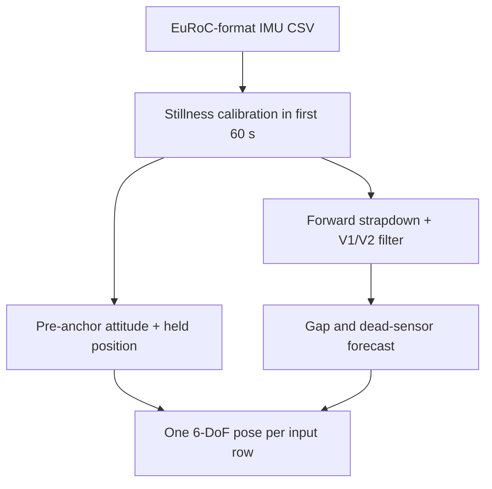

<div align="center">


<br>

<a href="https://research.samsung.com/"></a>
&nbsp;&nbsp;&nbsp;&nbsp;&nbsp;
<a href="https://www.samsungprism.com/"></a>

<p><strong>Samsung PRISM XR Hackathon Challenge 2026 · Track 3: Path Finder</strong></p>
<p>IMU-only, 6-DoF trajectory estimation under sensor degradation.</p>

[Challenge](#the-challenge) · [Architecture](#architecture) · [Measured results](#measured-results) · [Run](#run-vortex) · [Research notes](#research-notes)

</div>

---

## The challenge

An aircraft must navigate without GPS or cameras while its IMU becomes less reliable: noise and bias grow, readings disappear for up to two seconds, and the sensor eventually fails. The task is to reconstruct a **6-DoF pose for every input IMU row**, including the five seconds after failure, from a EuRoC-format `imu0/data.csv` alone. The evaluator uses EuRoC MAV and TUM-VI sequences with hidden ground truth.

| Input → output | Operating limits | Evaluation |
|---|---|---|
| Gyroscope + accelerometer → `timestamp tx ty tz qx qy qz qw`; one pose per input row, in order | Offline, one thread; **8 MB peak RAM** and **20 ms compute per second of IMU** | 60 points for trajectory (waypoints 30, blind prediction 20, dropouts 10); 40 for efficiency |

Small attitude and bias errors grow rapidly under inertial integration. Vortex anchors calibration on a detected still interval, then combines inertial integration with stillness and flight-envelope constraints. The current build also handles dropouts, detects zero or stuck IMU failure, and forecasts through missing data. On five **clean** EuRoC Machine Hall sequences, it records **4.84 m mean SE(3) absolute position error**; most of the gain over a never-moving baseline comes from a tuning sequence, so useful motion recovery remains an open problem. The estimator uses no camera, GPS, barometer, ground truth, or pretrained model.

## Architecture

**Implemented in the standalone submission entry point:**



`main.py` is the small submission launcher; it imports the standard-library estimator in [`pathfinder.py`](pathfinder.py). The estimator finds the longest usable still run in the first 60 seconds to estimate tilt, gravity magnitude, and gyro bias; when the strict test fails, a noise-tolerant second pass tries to recover a rest before falling back to first-second initialization. Before the anchor it holds position and integrates attitude backward. After the anchor it streams trapezoidal inertial integration through a 15-state error-state Kalman filter. Every input data row receives a pose. The [readable reference filter](vortex/core/witness.py) and optimized implementation agree exactly on recorded synthetic and real MH cases.

The forward filter uses **V1 stillness** (zero-velocity and gyro-bias updates) and **V2 flight envelope** (speed and running-position-volume constraints). Dropouts add covariance; invalid, zero, and exactly stuck sensor rows coast with velocity decaying toward zero on a 0.5 s time constant. V2's values were chosen on MH_01/02; learning them from each healthy flight is still pending. The noise meter exists but is switched off after its validation rule failed. See the [implementation plan](Docs/TRACK3_PLAN.md).

| IMU-only cue | Role | Status |
|---|---|---|
| V1 · Stillness | Zero-velocity and gyro-bias updates at detected rests | **On**; no in-flight rest on these MH runs |
| V2 · Flight envelope | Speed prior and position constraint around a running centre | **On**; primarily responsible for bounded drift, but flattens real motion |
| V3 · Rotor drag | Potential body-frame velocity from multirotor acceleration | **Off:** original rule returned NO-GO; a revised rule awaits Vicon Room validation |
| Turn physics, walking rhythm, tilt response | Conditional cues for motion and platform | Future experiments; require held-out gains and budget checks |

After-rest MH rotor-drag fits are exploratory; the revised, pre-registered rule requires Vicon Room data and a separate estimator gain before V3 can ship. A denoised V1 variant also failed its held-out improvement rule and remains in the reference implementation only. See the [drag study](Docs/DRAG.md) and [plan](Docs/TRACK3_PLAN.md).

## Measured results

**Five clean EuRoC Machine Hall sequences · whole-trajectory SE(3) aligned APE and 1 s RPE (metres).** MH_01/02 informed settings; MH_03–05 were used for held-out checks. These are recorded local runs, not hidden-evaluator scores.

| Estimator | Mean APE ↓ | Mean 1 s RPE ↓ | Reading |
|---|---:|---:|---|
| Never-moving trajectory | **5.25** | **0.878** | Essential sanity floor for these small-area flights |
| Step 6b · calibrated dead reckoning | 732.78 | 26.768 | Still interval corrects the moving-start gyro-bias failure, but drift grows |
| Step 7a · V1 + V2 | 5.29 | 0.936 | Drift bounded, but worse than the stationary floor |
| **Current · pre-anchor hold + calibration fallback** | **4.84** | **0.854** | Below the floor on the five-sequence mean; the gain is concentrated on MH_02 |

Current per-sequence APE: **MH_01 3.91 m · MH_02 3.85 m · MH_03 3.53 m · MH_04 6.38 m · MH_05 6.55 m**. Holding position before the anchor improves MH_02, a tuning sequence, from 5.97 to 3.85 m. On MH_03–05 the effect is within about 0.6%, so the mean's small edge over the stationary floor is **not evidence of general motion reconstruction**. V2 drives the large gain over dead reckoning; V1 adds little during MH flight because it mainly fires at the ground rest. The [generated results ledger](Docs/RESULTS.md) includes the per-sequence scores and ablations.

**Seeded degradation, with placeholder fault levels:** the current entry point passed the output contract on **60 degraded MH copies**; their recorded mean APE is **6.223 m**, 1 s RPE **1.084 m**, and five-second blind-window error growth **5.057 m**. These copies mix seeds and healthy-window lengths; the figures are not official challenge scores. In a separate held-out study of **54 seeded failure windows** on MH_03–05, with dead detection enabled in both readings, the 0.5 s velocity-decay forecast reduced mean blind growth from **8.643 to 4.368 m (49.5%)** against constant-velocity coasting; the blind RMSE fell from 8.380 to 7.137 m. This forecast primarily limits *new* error during failure; error already accumulated before failure remains. See the [degraded results](Docs/RESULTS.md) and [blind study](Docs/BLIND.md).

| Other check | Recorded outcome |
|---|---|
| Output and equivalence | All five MH runs pass the row contract; optimized `main.py` matches the reference on those sequences and synthetic cases ([tests](tests/test_core_equivalence.py)) |
| Latest automated suite | **194 passing tests**, Windows/Python 3.14 ([plan](Docs/TRACK3_PLAN.md)) |
| Real MH_01 efficiency | **1.89 ms per IMU-second**, 9.46 µs/row, **11.80 MB peak process RSS** with cached bytecode on Windows/Python 3.14 ([budget ledger](Docs/BUDGET.md)) |
| Submission packaging | Same output bytes on all **65** clean and degraded MH inputs; bundle verified on Python 3.12/3.13/3.14 and Docker image checked on those inputs ([bundle guide](bundle/README.md)) |
| Synthetic scoring cross-check | Worst reported difference **4.2 × 10⁻⁷ m** from independently installed evo ([ledger](Docs/EVO_CROSSCHECK.md)) |

The launcher loads matching, hash-checked bytecode shipped in the bundle, reducing measured MH_01 peak RSS by **3.5–3.8 MB** versus compiling the estimator from source across the tested Python versions. Without matching bytecode, Python compiles the source and this saving disappears; output stays identical. Compute is within the 20 ms/IMU-second limit on the measured laptop. The **8 MB whole-process RAM limit is still not met**; even bare CPython exceeds it there, and the evaluator's accounting definition is unresolved. The organiser's fault levels and evaluator are unknown; a plausible-noise or slowly freezing failure can evade the current dead-sensor detector. TUM-VI accuracy and real Galaxy S24 operation remain unverified.

**Confidence study:** a per-row position sigma exists in the reference analysis, but it did not rank error on the MH_01/02 tuning set (Spearman correlation **−0.07** over 344,494 scored rows). It is not in the submission entry point, and no calibrated per-row confidence is claimed ([coverage ledger](Docs/COVERAGE.md)).

## Run Vortex

Python 3.10+; `main.py` and `pathfinder.py` use only the standard library. Analysis and test tools use `pyproject.toml` dependencies.

```bash
python -m pip install -e '.[dev]'
pytest

# Format and output-contract smoke test; this is synthetic, not a flight.
python tools/synth_euroc.py imu.csv --rows 36000 --seed 0
python -S main.py imu.csv estimated_trajectory.txt
python -m vortex.check_output imu.csv estimated_trajectory.txt
```

The checker should report `PASS: 36000 input rows, 36000 output rows`. The synthetic file exercises parsing and output; it does not establish navigation accuracy.

For the submission artifact, [stage and verify the bundle](bundle/README.md) with `tools/make_bundle.py`. Run its `stage` step once under each Python version whose cached bytecode you want to include (tested: 3.12, 3.13, 3.14); `python tools/make_bundle.py zip --name NAME` creates `dist/NAME.zip`, and `python tools/make_bundle.py verify dist/NAME.zip` checks it. The bundle also includes a [Dockerfile](bundle/Dockerfile). A plain source checkout runs without staged bytecode, but has higher peak RSS.

For a local EuRoC sequence, put `MH_01_easy` under the ignored `data/euroc/` directory ([data setup](Docs/DATA.md)). The data is not committed:

```bash
python -S main.py data/euroc/MH_01_easy/mav0/imu0/data.csv estimated_trajectory.txt
python -m vortex.check_output data/euroc/MH_01_easy/mav0/imu0/data.csv estimated_trajectory.txt
python score.py --gt data/euroc/MH_01_easy --est estimated_trajectory.txt
```

To reproduce the five-sequence clean-data table with locally downloaded MH data and ground truth:

```bash
python tools/eval_euroc.py --tag my-current-clean --seqs MH_01_easy,MH_02_easy,MH_03_medium,MH_04_difficult,MH_05_difficult
```

This writes a tagged JSON record under `Docs/results/` and rebuilds `Docs/RESULTS.md`. Choose a new tag to keep the recorded runs intact.

To create a reproducible degraded copy and score the healthy, degraded, dropout, and blind windows, use the [fault injector](vortex/degrade.py) and [evaluator](tools/eval_euroc.py):

```bash
python -m vortex.degrade data/euroc/MH_01_easy data/degraded/MH_01_easy_s1 --seed 1
python tools/eval_euroc.py --tag my-current-degraded --degraded --seqs MH_01_easy_s1
```

The evaluator checks row coverage and fits alignment once on the clean run so a fault cannot be hidden by realignment. These fault levels are project placeholders; they are not the organiser's unpublished degradation script.

## Research notes

- [Track 3 plan](Docs/TRACK3_PLAN.md) — current stage, real-sequence diagnostics, design, and acceptance criteria.
- [Generated results](Docs/RESULTS.md) — clean and seeded degraded EuRoC metrics, stationary floor, and ablations.
- [Blind-window study](Docs/BLIND.md) — dead-sensor detection and five-second forecast comparisons.
- [Confidence coverage](Docs/COVERAGE.md) — why the experimental per-row sigma is not reported as calibrated confidence.
- [Submission bundle](bundle/README.md) — launcher, bytecode, manifest, Docker, and verification.
- [Budget ledger](Docs/BUDGET.md) and [efficiency floor](Docs/FLOOR.md) — synthetic and real timing, memory, and interpreter cost.
- [Rotor-drag study](Docs/DRAG.md) — pre-registered NO-GO result and explicitly labeled exploratory fits.
- [Scorer cross-check](Docs/EVO_CROSSCHECK.md) — evo comparison on synthetic trajectories.
- [Data instructions](Docs/DATA.md) and [third-party notices](THIRD_PARTY.md) — datasets stay outside the repository.

**Current solo entrant:** Arnav Jain. Vortex is a submission to the Samsung PRISM XR Hackathon Challenge 2026. Samsung Research and Samsung PRISM marks identify the challenge context.

<sub>Project code: [MIT](LICENSE). Brand marks are Samsung's; [Research mark](https://cdn.codeground.org/nsr/images/layout/logo-sr.png) and [PRISM mark](https://www.samsungprism.com/assets/images/prism_logo.png) are reproduced from their official sites.</sub>
