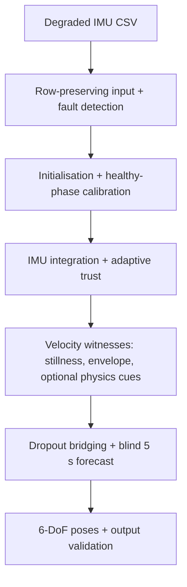

<div align="center">


<br>

<a href="https://research.samsung.com/"></a>
&nbsp;&nbsp;&nbsp;&nbsp;&nbsp;
<a href="https://www.samsungprism.com/"></a>

<p><strong>Samsung PRISM XR Hackathon Challenge 2026 · Track 3: Path Finder</strong></p>
<p>IMU-only, 6-DoF trajectory estimation under sensor degradation.</p>

[The challenge](#the-challenge) · [Solution design](#solution-design) · [Evidence](#what-is-verified) · [Run Vortex](#run-vortex) · [Technical notes](#technical-notes)

</div>

---

## The challenge

An aircraft must navigate without GPS or cameras while its IMU becomes less reliable: noise and bias grow, readings disappear for up to two seconds, and the sensor eventually fails. The task is to reconstruct a **6-DoF pose for every input IMU row**, including the five seconds after failure, from a EuRoC-format `imu0/data.csv` alone. The evaluator uses EuRoC MAV and TUM-VI sequences with hidden ground truth.

| Input and output | Operating limits | Evaluation |
|---|---|---|
| Gyroscope + accelerometer → `timestamp tx ty tz qx qy qz qw`; one pose per input row, same order | Offline, one thread; **8 MB peak RAM** and **20 ms compute per second of IMU** | 60 points for trajectory (waypoints 30, blind prediction 20, dropouts 10); 40 for efficiency |

Plain inertial integration compounds small biases into large position errors. Vortex's proposed answer is to extract several **velocity witnesses** from the same IMU, learn each witness on the healthy opening of a flight, and lower its trust when the sensor degrades. The scored path uses no camera, GPS, barometer, ground truth, or pretrained model.

## Solution design

> **One sensor, several physical clues.** A witness is a conditional hint about velocity, not a replacement for the IMU. The proposed filter fuses useful hints with fault-aware weights and preserves a pose for every row.



**This is the target estimator, not the current behavior of `main.py`.** The working entry point currently parses each row and writes an identity pose. The filter, witness fusion, and blind forecaster are the next implementation stages; no EuRoC or TUM-VI accuracy is claimed.

| Planned witness | Physical cue | Role |
|---|---|---|
| Stillness + flight envelope | Zero-velocity periods and a speed range learned on this flight | Core drift limits |
| Rotor drag + turn physics | Body-frame drag on a multirotor; lateral acceleration during steady turns | Switchable after held-out validation |
| Walking rhythm + tilt response | Gait on hand-held sequences; tilt/acceleration link on a multirotor | Platform-specific experiments and forecasting |

The proposed jamming meter adjusts trust as noise and bias rise. Additional cues stay behind switches unless an ablation improves held-out accuracy **and** fits the compute budget. See the [full design and acceptance plan](Docs/TRACK3_PLAN.md).

## What is verified

| In the repository today | Evidence |
|---|---|
| Standalone, standard-library `main.py` with exact nanosecond-to-second timestamp text conversion and one output pose per data row | Synthetic row, malformed-field, BOM, duplicate, and fault cases; [output contract and checker](vortex/check_output.py) |
| Seeded noise, bias, dropout, and terminal-failure injection | [Degradation tool](vortex/degrade.py) with recorded fault windows |
| ATE/RPE scoring, alignment modes, and separate healthy, degraded, dropout, and blind windows | [Scorer](vortex/scoring.py) cross-checked against independently installed evo on **synthetic** trajectories; worst reported difference **4.2 × 10⁻⁷ m** ([ledger](Docs/EVO_CROSSCHECK.md)) |
| Single-process timing and memory measurement across Linux and Windows | [Generated budget ledger](Docs/BUDGET.md), with input, machine, Python version, and commit recorded |
| Optional Galaxy S24 HTTP push and a synthetic station | Simulated pushes tested; a real S24 session has **not** been verified |

**Recorded baseline, not an estimator score.** The current identity-pose skeleton passed the output checker on a synthetic 36,000-row (180 s) EuRoC-format file. Measured on an Intel i7-14650HX with `python -S main.py`:

| Environment | Wall time per IMU-second | Peak process RSS | What this means |
|---|---:|---:|---|
| WSL2 Linux, Python 3.12 | 0.42 ms | 8.96 MB | I/O and formatting baseline only |
| Windows, Python 3.13 / 3.14 | 0.65 / 0.59 ms | 10.19 / 10.57 MB | Same synthetic baseline |

The README does **not** claim the 8 MB whole-process limit is met: CPython alone exceeded it on these machines. Whether the evaluator counts whole-process RSS or algorithm memory is still open. The latest recorded suite is **116 passing tests on Windows/Python 3.14**; [the plan](Docs/TRACK3_PLAN.md) states which inputs were synthetic and which real-data checks remain.

## Run Vortex

Python 3.10+; the submission entry point itself uses only the standard library. Analysis and test tools use the dependencies in `pyproject.toml`.

```bash
python -m pip install -e '.[dev]'
pytest

# Create an I/O test file (synthetic format, not a physical flight).
python tools/synth_euroc.py imu.csv --rows 36000 --seed 0
python -S main.py imu.csv estimated_trajectory.txt
python -m vortex.check_output imu.csv estimated_trajectory.txt
```

The checker should print `PASS: 36000 input rows, 36000 output rows`. **The generated poses are currently identities**, so this command tests the input/output contract, not navigation accuracy.

For a real sequence, place downloaded data under the ignored `data/` directory ([dataset setup](Docs/DATA.md)). To exercise fault injection and scoring:

```bash
python -m vortex.degrade data/euroc/MH_01_easy out/MH_01_s1 --seed 1
python -S main.py out/MH_01_s1/mav0/imu0/data.csv out/MH_01_s1/estimated_trajectory.txt
python -m vortex.check_output out/MH_01_s1/mav0/imu0/data.csv out/MH_01_s1/estimated_trajectory.txt
python score.py --gt data/euroc/MH_01_easy --est out/MH_01_s1/estimated_trajectory.txt --events out/MH_01_s1/degrade.json
```

This second path requires the locally downloaded EuRoC sequence and has **not yet been run on real EuRoC data** in the project record.

## Technical notes

- [Track 3 plan](Docs/TRACK3_PLAN.md) — current stage, target estimator, open questions, and verification status.
- [Budget ledger](Docs/BUDGET.md) and [efficiency floor](Docs/FLOOR.md) — generated timing and memory results, including the interpreter-only cost.
- [Scorer cross-check](Docs/EVO_CROSSCHECK.md) — numerical comparisons with evo on synthetic trajectories.
- [Data instructions](Docs/DATA.md) and [third-party notices](THIRD_PARTY.md) — datasets stay outside the repository.

**Team:** Arnav Jain (lead), Arya M, Nandhitha Chowdary Surapaneni. This is a team submission to the Samsung PRISM XR Hackathon Challenge 2026. Samsung Research and Samsung PRISM marks identify the challenge context; Vortex is the team's project.

<sub>Project code: [MIT](LICENSE). Brand marks are Samsung's; [Research mark](https://cdn.codeground.org/nsr/images/layout/logo-sr.png) and [PRISM mark](https://www.samsungprism.com/assets/images/prism_logo.png) are reproduced from their official sites.</sub>
