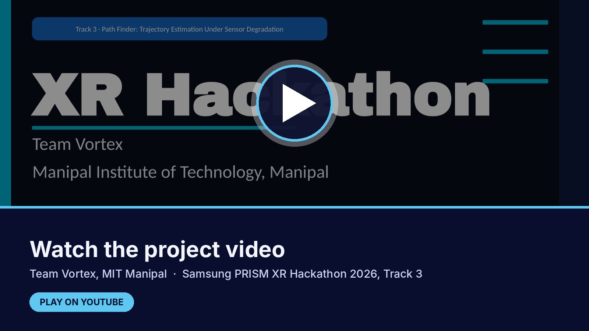
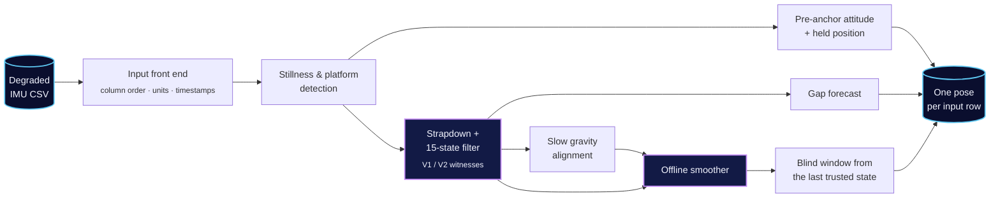
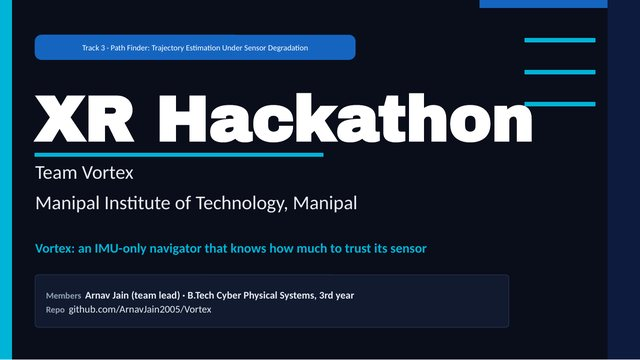
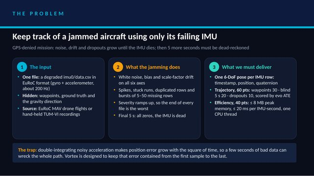
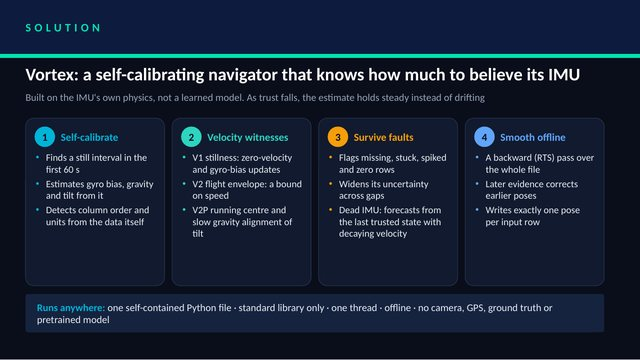
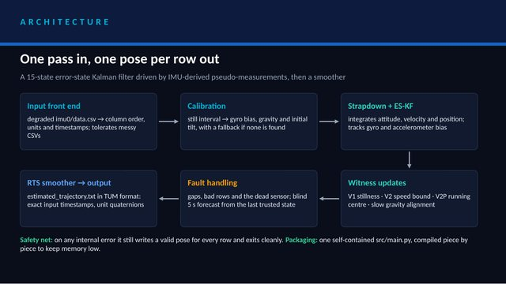
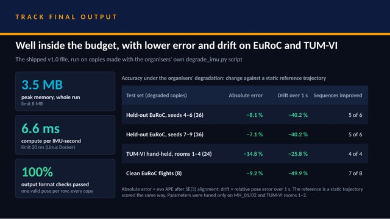
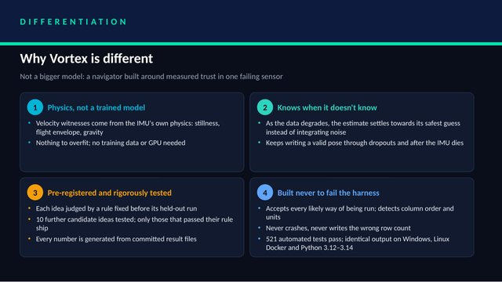
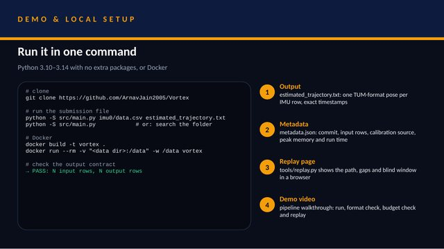
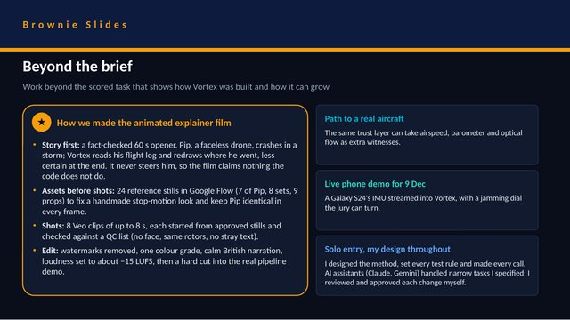

<div align="center">


<br>

<a href="https://research.samsung.com/"></a>
&nbsp;&nbsp;&nbsp;&nbsp;&nbsp;
<a href="https://www.samsungprism.com/"></a>

<h3>Samsung PRISM XR Hackathon Challenge 2026 · Track 3: Path Finder</h3>

<p>Vortex estimates a timestamped 6-DoF pose for every row of a degraded IMU recording,<br>
using nothing but that recording's gyroscope and accelerometer.</p>


<br><br>

<a href="https://youtu.be/l0N_V60-v3E"></a>

<sub><a href="https://youtu.be/l0N_V60-v3E"><b>Watch the project video on YouTube</b></a></sub>

<br><br>

<a href="https://www.youtube.com/watch?v=bPd4NMj70VY"></a>

<sub>The 60-second animated film: <a href="https://www.youtube.com/watch?v=bPd4NMj70VY">YouTube</a> · <a href="assets/vortex-film.mp4">MP4 download (21 MB)</a></sub>

<br><br>

[The problem](#the-problem) · [How it works](#how-vortex-works) · [Results](#results) · [Runtime and memory](#runtime-and-memory) · [Running Vortex](#running-vortex) · [Deck](#the-deck) · [Scope and limits](#scope-and-limits) · [Team and AI disclosure](#team-and-ai-disclosure)

</div>

---

## Summary

The challenge gives an offline IMU file whose gyroscope and accelerometer readings get worse over time: more noise and bias, rows that go missing, and a final five seconds of dead values. The output must be one pose per input row.

Vortex is a 15-state error-state Kalman filter with an offline smoother. It has no camera, GPS or learned model to lean on, so it adds IMU-derived constraints that we call velocity witnesses: zero-velocity updates when the sensor is clearly still, plus speed and position priors that keep drift bounded. It shuts out rows it can't trust, and it handles the final dead stretch with an explicit rule rather than by integrating zeros.

On six held-out EuRoC flight sequences, each degraded with the organisers' script as 36 copies (two column readings × three seeds), the mean aligned translational error is 3.440 m against 3.745 m for a constant-pose baseline (8.1% lower). The whole submission runs in 6.60 ms of wall time per second of IMU data in Linux Docker, against a 20 ms limit, with a peak heap of 3,476 KB against 8,192 KB.

Every number on this page comes from the generated ledger [`Docs/NUMBERS.md`](Docs/NUMBERS.md).

---

## The problem

A platform has to track itself with no GPS and no camera, using an IMU that gets steadily worse:

| Phase | What the sensor does | What the estimator has to do |
|:---|:---|:---|
| Healthy | Clean gyroscope and accelerometer | Calibrate gravity, tilt and gyro bias, and start tracking |
| Degrading | Noise, bias and scale drift grow; spikes, stuck runs and duplicated rows appear | Keep integrating without letting small errors grow without bound |
| Dropouts | Rows are physically missing | Carry the pose across the gap with growing uncertainty |
| Blind 5 s | Timestamps continue but the values are dead (exact zeros) | Still output a pose for every row |

<details>
<summary><b>The rules we follow</b> (organisers' slides and FAQ, 17 Nov 2026)</summary>

<br>

| Input and output | Operating limits | Evaluation |
|---|---|---|
| EuRoC-format `imu0/data.csv` (gyroscope and accelerometer) in; `timestamp tx ty tz qx qy qz qw` out, one pose per input row, in order, never appended | Python only; offline (batch smoothing allowed); one thread; 8 MB peak at heap level; 20 ms compute per second of IMU | SE(3)-aligned ATE (evo) against hidden ground truth: 60 points for trajectory (waypoints 30, blind prediction 20, dropouts 10) and 40 for efficiency (memory 20, runtime 20) |

The FAQ settled several points. The language is Python only (`main.py`), and the 8 MB limit is measured at algorithm/heap level, not as process RSS. Non-causal smoothing is allowed, scoring uses SE(3) Umeyama alignment, and dropouts are physically missing rows. Test data is any EuRoC or TUM-VI sequence degraded with the organisers' `degrade_imu.py`. How we handle the points the rules leave open is in [`Docs/SUBMISSION_RULES.md`](Docs/SUBMISSION_RULES.md).

</details>

Inertial navigation integrates acceleration twice, so a small tilt or bias error becomes metres of drift within seconds. Nothing outside the IMU file enters the estimator: no camera, GPS, barometer, ground truth or pretrained model.

---

## How Vortex works



1. **Input.** The front end works out the gyroscope/accelerometer column order, the timestamp unit (s, ms, µs or ns) and whether acceleration is in g or m/s², using the first 4,000 rows. It accepts a UTF-8 BOM, CRLF line endings, a `#` header or no header, blank lines, spaces after commas and extra trailing columns. Order detection is a heuristic based on the data. When the data can't separate the two orders, the header decides, and a file with no useful header is read gyroscope-first.
2. **Calibration.** Gyro bias, gravity magnitude and initial tilt come from the longest still interval in the first 60 s. If there is none, a shorter fallback window is used. A statistic of accelerometer vibration over the whole file decides whether the recording comes from a multirotor or a hand-held device. That choice sets how tight the speed and position priors are.
3. **Filtering.** A 15-state error-state Kalman filter (position, velocity, attitude and both biases) runs on strapdown integration. Its constraints are described in the table below.
4. **Gaps and bad rows.** Missing rows are not invented; the filter's uncertainty grows across the gap. Rows with non-finite or extreme values, an all-zero accelerometer, or five identical consecutive readings are treated as missing. Across a gap, velocity decays with a 0.5 s time constant instead of being extrapolated.
5. **Smoothing.** The task is offline, so a fixed-interval Rauch–Tung–Striebel smoother revises earlier poses using later data. When the gyroscope becomes noisy, a slow, windowed gravity alignment also corrects roll and pitch.
6. **The blind window.** If the file ends in at least 1 s of dead rows, Vortex marks a point 3 s before that run. From there on, each pose keeps the attitude of the last pose before that point. Its position moves in a straight line to the centroid of all earlier positions, arriving there when the dead run starts, and stays there to the end of the file. This is a deliberate, prior-based estimate. It is not recovered motion.

| Constraint | What it contributes | Kind |
|:---|:---|:---|
| V1, stillness | When two consecutive 0.25 s bins are still and steady, a zero-velocity update and a gyro-bias update | Measurement when stillness is detected |
| V2, speed envelope | A zero-mean speed prior (2 m/s horizontal and 0.3 m/s vertical for a multirotor; tighter when hand-held), applied when V1 is not active | Model prior: it restrains drift but cannot tell real motion from velocity error |
| V2P, running centre | A weak pull of position toward a slowly moving centre computed from the estimate itself | Model prior, not a position measurement |
| Gravity alignment | Roll and pitch pseudo-measurements from 4 s-averaged specific force, weighted up only when the gyroscope is noisy | Pseudo-measurement from the IMU |

Each feature is a switch that ships only if it passed a pass/fail rule committed before the held-out comparison. The full record is in the [decision log](Docs/TRACK3_PLAN.md), and the implementation is described function by function in [`Docs/METHOD.md`](Docs/METHOD.md).

---

## Results

<div align="center">

</div>

### How the comparison works

The baseline is a constant-pose trajectory: one fixed pose for every row of the same input. Both outputs are scored the same way, with SE(3) Umeyama alignment fitted per run (as the organisers do) followed by translational RMSE. Because the alignment can place the baseline at the centre of the true path, beating it is a meaningful first check that the estimate carries motion information. The baseline is not a lower bound on error, and it is not a production navigation system. [Scoring method](Docs/METHOD.md) · [source values and run tags](Docs/NUMBERS.md)

The challenge scores full-trajectory (waypoint) error, error in the blind 5 s and error inside dropouts. The 1 s relative pose error (RPE) is an extra diagnostic of local motion; the challenge does not score it. All headline errors are translational. Orientation accuracy is not reported separately.

### What the data covers

- **Held-out EuRoC:** six flight sequences (MH_03–05, V1_01–03) that were never used for tuning. Each is degraded with the organisers' script under two column readings and three seeds (4–6), giving 36 copies of six flights, not 36 independent flights.
- **Repeat trials:** seeds 7–9 degrade the same six sequences again. They test robustness to a fresh degradation, not new trajectories.
- **Clean EuRoC:** eight undegraded sequences (MH_01–05, V1_01–03), including the tuning flights MH_01 and MH_02.
- **TUM-VI:** hand-held recordings. Rooms 1–2 were used for tuning; rooms 3–4 are held out. The rooms 1–4 figures below include the tuning rooms.
- The EuRoC recordings are real flights. The faults in every evaluation are applied by the organisers' degradation script.

### What the results show, and where they stop

- Full-trajectory error is lower than the baseline on five of the six held-out sequences, in each column reading. The exception is V1_01: worse than the baseline in both readings, on both seed sets.
- On the repeat trials (seeds 7–9) the full-trajectory result holds at 3.481 m vs 3.748 m. Error inside dropout gaps, though, is slightly higher than the baseline there (3.298 m vs 3.256 m, +1.3%).
- In the blind 5 s, Vortex is level with the baseline (2.494 m vs 2.504 m on seeds 4–6). The blind-window rule holds the estimate steady; it does not predict the motion.
- Local motion (1 s RPE) is 40.2% lower on the held-out copies and 49.9% lower on the clean sequences.
- Every output passed the format contract: 36 of 36 copies on seeds 4–6, 36 of 36 on seeds 7–9 and 24 of 24 on TUM-VI.

<details>
<summary><b>Full results tables</b></summary>

<br>

| Set · metric | Vortex | Constant-pose baseline | Difference |
|---|---:|---:|---:|
| Held-out EuRoC, seeds 4–6 (36 copies) · full APE | 3.440 m | 3.745 m | 8.1% lower |
| Held-out EuRoC, seeds 4–6 · gap-window RMSE | 3.478 m | 3.626 m | 4.1% lower |
| Held-out EuRoC, seeds 4–6 · blind 5 s RMSE | 2.494 m | 2.504 m | 0.4% lower (level) |
| Held-out EuRoC, seeds 4–6 · 1 s RPE (diagnostic) | 0.562 m | 0.941 m | 40.2% lower |
| Repeat trials, seeds 7–9 (36 copies) · full APE | 3.481 m | 3.748 m | 7.1% lower |
| Repeat trials, seeds 7–9 · gap-window RMSE | 3.298 m | 3.256 m | 1.3% higher |
| Repeat trials, seeds 7–9 · blind 5 s RMSE | 2.495 m | 2.505 m | 0.4% lower (level) |
| Repeat trials, seeds 7–9 · 1 s RPE (diagnostic) | 0.563 m | 0.943 m | 40.2% lower |
| Clean EuRoC, 8 sequences incl. tuning · full APE | 3.570 m | 3.930 m | 9.2% lower |
| Clean EuRoC · 1 s RPE (diagnostic) | 0.407 m | 0.813 m | 49.9% lower |
| TUM-VI held-out rooms 3–4 (12 copies) · full APE | 1.083 m | 1.164 m | 7.0% lower |
| TUM-VI held-out rooms 3–4 · 1 s RPE (diagnostic) | 1.012 m | 1.260 m | 19.7% lower |
| TUM-VI rooms 1–4 incl. tuning (24 copies) · full APE | 0.969 m | 1.137 m | 14.8% lower |
| TUM-VI rooms 1–4 · gap-window RMSE | 0.988 m | 1.078 m | 8.3% lower |
| TUM-VI rooms 1–4 · blind 5 s RMSE | 0.699 m | 0.709 m | 1.4% lower (level) |
| TUM-VI rooms 1–4, clean (4 sequences) · full APE | 0.879 m | 1.137 m | 22.6% lower |

**Column readings.** The organisers' script can be given the IMU columns gyroscope-first (reading a, the raw EuRoC order) or accelerometer-first (reading b). Vortex detects the order from the data, and both readings are scored (held-out EuRoC, seeds 4–6):

| Metric | Vortex a / baseline | Vortex b / baseline | a vs baseline | b vs baseline |
|---|---:|---:|---:|---:|
| Full APE | 3.506 / 3.745 m | 3.373 / 3.745 m | 6.4% lower | 9.9% lower |
| 1 s RPE (diagnostic) | 0.606 / 0.941 m | 0.519 / 0.941 m | 35.5% lower | 44.9% lower |

**Per-sequence counts.** Lower full APE than the baseline: 5 of 6 held-out sequences in each reading on seeds 4–6; 4 of 6 (reading a) and 5 of 6 (reading b) on seeds 7–9; 7 of 8 clean EuRoC sequences; 4 of 4 TUM-VI rooms (rooms 1–2 being tuning rooms).

[Verified figures](Docs/NUMBERS.md) · [generated results](Docs/RESULTS.md) · [decision log](Docs/TRACK3_PLAN.md)

</details>

---

## Runtime and memory

<div align="center">

</div>

All figures are for the submitted `src/main.py`, run from source (no bytecode ships), on the official degraded copy `MH_03_medium_b_s1` (reading b, 26,106 rows). Heap is the tracemalloc peak for the whole run, started before the file is compiled.

<details>
<summary><b>Measurement details</b></summary>

<br>

| Measurement | Where | Value | Limit |
|---|---|---:|---:|
| Wall time per IMU-second, whole process from source, 15-run median | Linux Docker, `python:3.12.7-slim-bookworm` | 6.60 ms (6.56–7.67 ms over seven inputs) | 20 ms |
| Wall time per IMU-second | Windows 11, Python 3.14.7 | 5.82 ms | 20 ms |
| Time per row | Windows 11, Python 3.14.7 | 30.1 µs | — |
| Peak heap, whole run from source | Windows 11, Python 3.14.7 | 3,476 KB | 8,192 KB |
| Peak heap, whole run from source | Windows 11, Python 3.13.5 | 4,158 KB | 8,192 KB |
| Automated tests | Windows 11, Python 3.14.7, 22 Nov | 521 passed, 0 failed | — |

The challenge limit is stated as compute time; we report wall time, which also includes process start-up and file I/O. Process RSS includes the interpreter and is not the challenge's memory metric. [Budget record](Docs/BUDGET.md) · [Docker measurements](Docs/DOCKER_BENCH.md) · [clean-machine check](Docs/CLEAN_MACHINE.md)

</details>

---

## Running Vortex

### The submitted file

The submission is one self-contained file, `src/main.py`: Python 3 standard library only, single-threaded, offline and deterministic.

```bash
python -S src/main.py IN OUT          # IN: the IMU csv or a sequence folder; OUT: the trajectory file or a folder
python -S src/main.py                 # no arguments: looks for imu0/data.csv, mav0/imu0/data.csv, data.csv, then a single *.csv here
python -S src/main.py --input IN --output OUT    # also -i / -o
```

With no `OUT`, the trajectory is written to `estimated_trajectory.txt`.

### Docker

The repository [`Dockerfile`](Dockerfile) generates the same single file from `pathfinder.py` and runs it with `python -S` on `python:3.12.7-slim-bookworm`.

```bash
docker build -t vortex .
docker run --rm -v "<folder with the csv>:/data" -w /data vortex
docker run --rm -v "<folder with the csv>:/data" vortex /data/data.csv /data/estimated_trajectory.txt
```

On 22 Nov the image's `/app/main.py` was byte-identical to the submission zip's `src/main.py`, and both `docker run` forms reproduced the zip's `estimated_trajectory.txt` byte for byte. Timings measured inside this image are in [`Docs/DOCKER_BENCH.md`](Docs/DOCKER_BENCH.md).

<details>
<summary><b>Repository tests and a synthetic check</b></summary>

<br>

No dataset is needed. The synthetic file checks the format and the output contract, not navigation accuracy.

```bash
python -m pip install -e '.[dev]' && pytest
python tools/synth_euroc.py imu.csv --rows 36000 --seed 0
python -S main.py imu.csv estimated_trajectory.txt
python -m vortex.check_output imu.csv estimated_trajectory.txt     # PASS: 36000 input rows, 36000 output rows
```

`main.py` in the repository is a stub that runs `pathfinder.py`. Both use only the standard library; the analysis tools and tests need the dependencies in `pyproject.toml`.

</details>

<details>
<summary><b>Building the submission bundle</b></summary>

<br>

`src/main.py` is generated from [`pathfinder.py`](pathfinder.py) by [`tools/make_bundle.py`](tools/make_bundle.py) and never edited by hand. It holds `pathfinder.py` verbatim as source text under a short loader that compiles it one function at a time. This keeps the whole-run heap between 3,476 KB (Python 3.14.7) and 4,158 KB (3.13.5); compiling the full file in one go would use most of the 8 MB budget. Error messages keep `pathfinder.py`'s line numbers. The generated file's output was checked byte-for-byte against the repository's `python -S main.py` on all 412 copies when the layout was chosen (official EuRoC and TUM-VI degraded copies plus clean sequences), and again for v1.0. It is also identical across CPython 3.12, 3.13 and 3.14.

```bash
python tools/make_bundle.py stage --dir "$PWD/dist/stage"
python tools/make_bundle.py same --dir "$PWD/dist/stage"                   # byte-identity against `python -S main.py`
python tools/make_bundle.py eval IMU.csv --dir "$PWD/dist/stage"           # estimated_trajectory.txt + metadata.json
python tools/make_bundle.py zip --name Vortex --dir "$PWD/dist/stage" --out "$PWD/dist"
python tools/make_bundle.py verify "$PWD/dist/Vortex.zip"
```

The v1.0 bundle is tag `v1.0`, `dist/vortex_v1.0.zip`, sha256 `e251c4010248caf5103bbf2923122146bba64ae7e2b225069a89672ffbd4447c`. It passed `verify` on Windows with Python 3.14.7 and 3.13.5 and on WSL2 with Python 3.12.3. Its `estimated_trajectory.txt` is our output for the official degraded copy `MH_03_medium_b_s1` (26,106 rows); the bundle README and `metadata.json` name the input and the commit. [Bundle guide](bundle/README.md)

</details>

<details>
<summary><b>Reproducing the scores</b></summary>

<br>

Datasets and ground truth are not shipped; see [data setup](Docs/DATA.md). Official-copy scores also need the organisers' `degrade_imu.py`, which is not committed. `python -m vortex.degrade` is the project's own fault model, used only for workflow checks.

```bash
python -S main.py data/euroc/MH_01_easy/mav0/imu0/data.csv estimated_trajectory.txt
python -m vortex.check_output data/euroc/MH_01_easy/mav0/imu0/data.csv estimated_trajectory.txt
python score.py --gt data/euroc/MH_01_easy --est estimated_trajectory.txt
python tools/eval_euroc.py --tag local-clean --seqs MH_01_easy,MH_02_easy,MH_03_medium   # rebuilds Docs/RESULTS.md
```

The charts on this page are generated from `Docs/NUMBERS.md`:

```bash
python tools/readme_figures.py           # assets/readme-results.svg, assets/readme-budget.svg
python tools/readme_figures.py --check   # fails if they are out of date
```

</details>

<details>
<summary><b>Invocation forms, output format and fallback behaviour</b></summary>

<br>

Every invocation form works with or without `-S`, under `-I`, and from any working directory. The output has one line `timestamp tx ty tz qx qy qz qw` per input data row (a row that is not blank and does not start with `#`), in input order. Timestamps are the input nanoseconds with the decimal point moved by integer arithmetic, so they are reproduced exactly.

If the estimator raises an exception (`MemoryError` included), `main.py` writes a note on stderr and writes a constant pose (origin, identity attitude) for every input row with the exact timestamps, then exits 0. If the estimator cannot be loaded at all, the loader does the same. Wrong arguments or no input found exit with code 2. An input that cannot be read, or an output that cannot be written, exits with code 1.

</details>

---

## The deck

<div align="center">

<table>
<tr>
<td><a href="Docs/deck/ManipalInstituteofTechnology_Vortex.pdf"></a></td>
<td><a href="Docs/deck/ManipalInstituteofTechnology_Vortex.pdf"></a></td>
<td><a href="Docs/deck/ManipalInstituteofTechnology_Vortex.pdf"></a></td>
</tr>
<tr>
<td><a href="Docs/deck/ManipalInstituteofTechnology_Vortex.pdf"></a></td>
<td><a href="Docs/deck/ManipalInstituteofTechnology_Vortex.pdf"></a></td>
<td><a href="Docs/deck/ManipalInstituteofTechnology_Vortex.pdf"></a></td>
</tr>
<tr>
<td><a href="Docs/deck/ManipalInstituteofTechnology_Vortex.pdf"></a></td>
<td><a href="Docs/deck/ManipalInstituteofTechnology_Vortex.pdf"></a></td>
<td><a href="Docs/deck/ManipalInstituteofTechnology_Vortex.pdf"></a></td>
</tr>
</table>

<sub>Select any slide to open the full deck: <a href="Docs/deck/ManipalInstituteofTechnology_Vortex.pdf">PDF</a> · <a href="Docs/deck/ManipalInstituteofTechnology_Vortex.pptx">PowerPoint</a></sub>

</div>

---

## Scope and limits

- Vortex is an offline estimator. It reads the whole recording, smooths it and then writes the trajectory. It has not been demonstrated as an onboard, real-time or safety-critical navigation system, and it has not been flown on hardware.
- The reported errors are translational, after SE(3) alignment. Orientation is estimated and written for every row, but its accuracy is not reported separately.
- The speed and running-centre constraints are priors, not observations of true velocity or position. They are what keep drift bounded, and they would misjudge motion that differs from the assumed envelope.
- The blind-window output is a prior-based estimate built from the last trusted pose and the trajectory's centroid, not a forecast of the actual motion.
- The results come from public EuRoC and TUM-VI recordings with faults applied by the organisers' script. The hidden evaluation data may behave differently.

---

## Reference

<details>
<summary><b>Switches in the shipped estimator</b></summary>

<br>

Every `*_ON` assignment in the shipped [`pathfinder.py`](pathfinder.py) is on, and each passed its registered rule before shipping.

| Switch | What it does | Record |
|---|---|---|
| `FRONT_ON` | Input format detection | [Step 2](Docs/TRACK3_PLAN.md) |
| `CAL_NOISE_ON` | Noise-tolerant still-calibration fallback | [Step 6e](Docs/TRACK3_PLAN.md) |
| `BGCAP_ON` | Caps false stillness during steady rotation | [Step F](Docs/TRACK3_PLAN.md) |
| `P0V_ON` | Wider initial velocity uncertainty without a still anchor | [Step F](Docs/TRACK3_PLAN.md) |
| `REFRESH_ON` | Refreshes the cached sample after a correction | [Step F](Docs/TRACK3_PLAN.md) |
| `SMOOTH_ON` | Offline fixed-interval smoother | [Step 6](Docs/TRACK3_PLAN.md) |
| `PLATFORM_ON` | Multirotor vs hand-held detection; selects the envelope | [Step 7](Docs/TRACK3_PLAN.md) |
| `TILT_ON` | Gravity alignment when the gyroscope is noisy | [Step L2](Docs/TRACK3_PLAN.md) |
| `TILT_LAG` | Gyro-bias terms in that gravity alignment | [Step L2](Docs/TRACK3_PLAN.md) |
| `BLIND_ON` | Blind window from the last trusted pose | [Step L3](Docs/TRACK3_PLAN.md) |
| `BLIND_DEAD_ONLY` | Acts only on a detected trailing dead run | [Step L3](Docs/TRACK3_PLAN.md) |
| `V1_ON` | Stillness witness | [Step 7a](Docs/TRACK3_PLAN.md) |
| `V2_ON` | Speed prior | [Step 7a](Docs/TRACK3_PLAN.md) |
| `V2P_ON` | Running-centre position prior | [Step 7a](Docs/TRACK3_PLAN.md) |
| `GAP_ON` | Extra covariance after a dropout | [Step 6c](Docs/TRACK3_PLAN.md) |
| `DEAD_ON` | Exact-zero and stuck-sensor detection | [Step 8a](Docs/TRACK3_PLAN.md) |
| `FC_ON` | Velocity decay during gaps and dead rows | [Step 8a](Docs/TRACK3_PLAN.md) |

Candidates that did not pass their rule stay switched off in the [reference filter](vortex/core/witness.py) and are not part of the submission.

</details>

<details>
<summary><b>Repository map</b></summary>

<br>

| Path | Contents |
|---|---|
| [`pathfinder.py`](pathfinder.py) | The estimator, standard library only; the source of the shipped `src/main.py` |
| [`main.py`](main.py) | Repository entry point (a stub that runs `pathfinder.py`) |
| [`bundle/`](bundle/README.md) | README and Dockerfile that ship inside the submission zip |
| [`vortex/`](vortex) | Reference filter (`core/`), metrics, scoring, output checker, fault model |
| [`tools/`](tools) | Bundle builder, evaluators, judging scripts for each registered rule, benchmarks, chart generator |
| [`tests/`](tests) | pytest suite (521 passed on 22 Nov) |
| [`Docs/`](Docs) | Plan, generated numbers and results, budget, method, deck |
| [`score.py`](score.py), [`benchmark.py`](benchmark.py) | SE(3)-aligned scorer; runtime and heap gate |
| `main.cpp`, `Dockerfile.ccore` | A C++ port kept as a speed experiment; not part of the Python submission |

</details>

<details>
<summary><b>Documentation</b></summary>

<br>

- [Project deck](Docs/deck/ManipalInstituteofTechnology_Vortex.pdf) ([PowerPoint](Docs/deck/ManipalInstituteofTechnology_Vortex.pptx))
- [Method](Docs/METHOD.md): the shipped v1.0 estimator, function by function
- [Decision log](Docs/TRACK3_PLAN.md): every registered rule and its verdict
- [Verified figures](Docs/NUMBERS.md): every quotable number, with source tags
- [Generated results](Docs/RESULTS.md): clean and degraded EuRoC metrics, constant-pose baseline, ablations
- [Official-script baseline](Docs/STEP2_BASELINE.md) and [TUM-VI baseline](Docs/TUMVI_BASELINE.md)
- [Budget ledger](Docs/BUDGET.md), [efficiency floor](Docs/FLOOR.md), [Docker measurements](Docs/DOCKER_BENCH.md), [clean-machine check](Docs/CLEAN_MACHINE.md)
- [Scorer cross-check](Docs/EVO_CROSSCHECK.md): our scorer against evo on synthetic trajectories
- [Submission rules](Docs/SUBMISSION_RULES.md), [data instructions](Docs/DATA.md) and [third-party notices](THIRD_PARTY.md)

</details>

---

## Team and AI disclosure

Vortex is the work of Arnav Jain, solo entrant, Manipal Institute of Technology.

Arnav conceived the project and owned every decision in it:

- **Approach.** He chose the velocity-witness design and the IMU-only, no-pretrained-model constraint.
- **Rules.** He set the rules every change had to follow. Features are switches that are off by default, and pass/fail rules are committed before held-out data is touched. Ground truth is used only for scoring, and every number comes from a generated ledger.
- **Testing.** He decided which data was for tuning and which was held out, and ran the datasets and the test suite on his own machine.
- **Oversight.** He planned and assigned every task, reviewed each one, and approved and merged every change into this repository.
- **Film.** He chose the film's story and directed its production.

AI tools assisted under that direction, and Arnav oversaw every task they took on:

| Tool | How it helped |
|---|---|
| Claude (Anthropic), via Claude Code | Implementation of estimator code, tests, evaluation scripts and documentation. Each piece followed a written task from Arnav and was merged only after his review |
| Gemini, in Google Antigravity | Dataset preparation, benchmark and Docker runs, clean-machine verification and demo footage |
| ChatGPT (OpenAI) | Technical review and drafting for the deck and script |
| Google Flow | AI animation for the film |
| ElevenLabs | AI voice for the film |
| Claude | Writing support for the film |

Every approach, decision rule and ship decision was Arnav's call.

---

<div align="center">

Built by Arnav Jain · Manipal Institute of Technology · Submission name `VORTEX` (solo entry)

<sub>Code: [MIT](LICENSE). Samsung Research and Samsung PRISM marks identify the challenge context and are Samsung's; the [Research mark](https://cdn.codeground.org/nsr/images/layout/logo-sr.png) and [PRISM mark](https://www.samsungprism.com/assets/images/prism_logo.png) are reproduced from their official sites.</sub>

</div>
