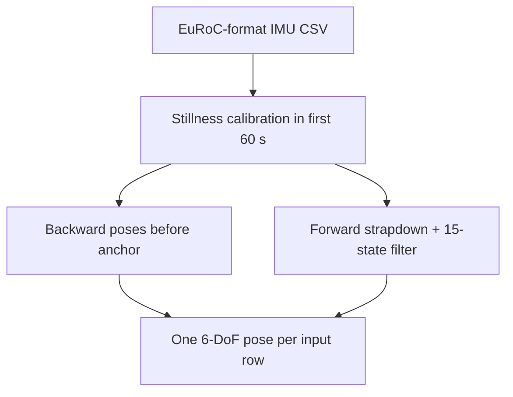

<div align="center">


<br>

<a href="https://research.samsung.com/"></a>
&nbsp;&nbsp;&nbsp;&nbsp;&nbsp;
<a href="https://www.samsungprism.com/"></a>

<p><strong>Samsung PRISM XR Hackathon Challenge 2026 · Track 3: Path Finder</strong></p>
<p>IMU-only, 6-DoF trajectory estimation under sensor degradation.</p>

[Challenge](#the-challenge) · [Architecture](#architecture) · [Measured results](#measured-results) · [Run](#run-vortex) · [Research notes](#research-notes)

</div>

---

## The challenge

An aircraft must navigate without GPS or cameras while its IMU becomes less reliable: noise and bias grow, readings disappear for up to two seconds, and the sensor eventually fails. The task is to reconstruct a **6-DoF pose for every input IMU row**, including the five seconds after failure, from a EuRoC-format `imu0/data.csv` alone. The evaluator uses EuRoC MAV and TUM-VI sequences with hidden ground truth.

| Input → output | Operating limits | Evaluation |
|---|---|---|
| Gyroscope + accelerometer → `timestamp tx ty tz qx qy qz qw`; one pose per input row, in order | Offline, one thread; **8 MB peak RAM** and **20 ms compute per second of IMU** | 60 points for trajectory (waypoints 30, blind prediction 20, dropouts 10); 40 for efficiency |

Small attitude and bias errors grow rapidly under inertial integration. Vortex now anchors calibration on a detected still interval and uses a compact error-state filter with two IMU-only constraints: stillness and a flight envelope. On five **clean** EuRoC Machine Hall sequences, the current build bounds the drift to 3.53–6.55 m SE(3) absolute position error. Its mean is still level with a never-moving baseline; recovering useful motion is the next challenge. The estimator uses no camera, GPS, barometer, ground truth, or pretrained model.

## Architecture

**Implemented in the standalone submission entry point:**



`main.py` uses only the Python standard library. It finds the longest usable still run in the first 60 seconds to estimate tilt, gravity magnitude, and gyro bias. It reconstructs the earlier rows by backward dead reckoning, then streams forward with trapezoidal inertial integration and a 15-state error-state Kalman filter. If no still run qualifies, it falls back to first-second initialization. Invalid samples and timestamp gaps retain the one-pose-per-row contract. The [readable reference filter](vortex/core/witness.py) and optimized entry point agree exactly on recorded synthetic and all five real MH sequences.

The forward filter currently uses **V1 stillness** (zero-velocity and gyro-bias updates) and **V2 flight envelope** (speed and running-position-volume constraints). V2's values were chosen on MH_01/02; learning them from each healthy flight is still pending. Pre-anchor rows are not filtered. The next stages are a sensor-quality meter, explicit dropout handling, a motion-informative in-flight cue, and a five-second blind forecaster. See the [implementation plan](Docs/TRACK3_PLAN.md).

| IMU-only cue | Role | Status |
|---|---|---|
| V1 · Stillness | Zero-velocity and gyro-bias updates at detected rests | **On**; no in-flight rest on these MH runs |
| V2 · Flight envelope | Speed prior and position constraint around a running centre | **On**; primarily responsible for bounded drift, but flattens real motion |
| V3 · Rotor drag | Potential body-frame velocity from multirotor acceleration | **Off:** pre-registered whole-sequence rule returned NO-GO on MH_01–05 |
| Turn physics, walking rhythm, tilt response | Conditional cues for motion and platform | Future experiments; require held-out gains and budget checks |

After-rest rotor-drag fits are promising but **post hoc**; they do not reverse the registered NO-GO decision. The protocol, negative result, and plots are in the [drag study](Docs/DRAG.md).

## Measured results

**Five clean EuRoC Machine Hall sequences · whole-trajectory SE(3) aligned APE and 1 s RPE (metres).** MH_01/02 were used to choose V2 settings; MH_03–05 were evaluated once with those settings. These are recorded local runs, not hidden-evaluator scores.

| Estimator | Mean APE ↓ | Mean 1 s RPE ↓ | Reading |
|---|---:|---:|---|
| Never-moving trajectory | **5.25** | **0.878** | Essential sanity floor for these small-area flights |
| Step 6b · calibrated dead reckoning | 732.78 | 26.768 | Still interval corrects the moving-start gyro-bias failure, but drift grows |
| **Current step 7a · V1 + V2** | **5.29** | **0.936** | Drift is bounded, yet **does not beat the stationary floor** |

Current per-sequence APE: **MH_01 3.99 m · MH_02 5.97 m · MH_03 3.53 m · MH_04 6.41 m · MH_05 6.55 m**. The V2 constraints drive the gain over dead reckoning; V1 adds little on these flights because it fires at the opening ground rest, not in flight. The [generated results ledger](Docs/RESULTS.md) includes every sequence, ablation, final error, and alignment. A five-sequence clean-data result does **not** establish accuracy under injected noise, bias drift, dropouts, or terminal failure.

| Other check | Recorded outcome |
|---|---|
| Output and equivalence | All five MH runs pass the row contract; optimized `main.py` matches the reference on those sequences and synthetic cases ([tests](tests/test_core_equivalence.py)) |
| Latest automated suite | **155 passing tests**, Windows/Python 3.14 ([plan](Docs/TRACK3_PLAN.md)) |
| Real MH_01 efficiency | **1.74 ms per IMU-second**, 8.69 µs/row, **15.36 MB peak process RSS** on Windows/Python 3.14 ([budget ledger](Docs/BUDGET.md)) |
| Synthetic scoring cross-check | Worst reported difference **4.2 × 10⁻⁷ m** from independently installed evo ([ledger](Docs/EVO_CROSSCHECK.md)) |

Compute is within the 20 ms/IMU-second limit on the measured laptop. The **8 MB whole-process RAM limit is not met**; even bare CPython exceeds it there, and the evaluator's accounting definition is unresolved. TUM-VI accuracy, degraded real-data accuracy, the five-second forecast, and real Galaxy S24 operation remain unverified or unimplemented as noted above.

## Run Vortex

Python 3.10+; the submission entry point itself uses only the standard library. Analysis and test tools use `pyproject.toml` dependencies.

```bash
python -m pip install -e '.[dev]'
pytest

# Format and output-contract smoke test; this is synthetic, not a flight.
python tools/synth_euroc.py imu.csv --rows 36000 --seed 0
python -S main.py imu.csv estimated_trajectory.txt
python -m vortex.check_output imu.csv estimated_trajectory.txt
```

The checker should report `PASS: 36000 input rows, 36000 output rows`. The synthetic file exercises parsing and output; it does not establish navigation accuracy.

For a local EuRoC sequence, put `MH_01_easy` under the ignored `data/euroc/` directory ([data setup](Docs/DATA.md)). The data is not committed:

```bash
python -S main.py data/euroc/MH_01_easy/mav0/imu0/data.csv estimated_trajectory.txt
python -m vortex.check_output data/euroc/MH_01_easy/mav0/imu0/data.csv estimated_trajectory.txt
python score.py --gt data/euroc/MH_01_easy --est estimated_trajectory.txt
```

To reproduce the five-sequence clean-data table with locally downloaded MH data and ground truth:

```bash
python tools/eval_euroc.py --tag my-step7a --seqs MH_01_easy,MH_02_easy,MH_03_medium,MH_04_difficult,MH_05_difficult
```

This writes a tagged JSON record under `Docs/results/` and rebuilds `Docs/RESULTS.md`. Choose a new tag to keep the recorded runs intact.

To create a reproducible degraded sequence and score separate healthy, degraded, dropout, and blind windows, use the [fault injector](vortex/degrade.py) and [scorer](vortex/scoring.py):

```bash
python -m vortex.degrade data/euroc/MH_01_easy out/MH_01_s1 --seed 1
python -S main.py out/MH_01_s1/mav0/imu0/data.csv out/MH_01_s1/estimated_trajectory.txt
python -m vortex.check_output out/MH_01_s1/mav0/imu0/data.csv out/MH_01_s1/estimated_trajectory.txt
python score.py --gt data/euroc/MH_01_easy --est out/MH_01_s1/estimated_trajectory.txt --events out/MH_01_s1/degrade.json
```

This is a reproducible evaluation workflow; the current estimator has not demonstrated robustness to those injected faults on real sequences.

## Research notes

- [Track 3 plan](Docs/TRACK3_PLAN.md) — current stage, real-sequence diagnostics, design, and acceptance criteria.
- [Generated results](Docs/RESULTS.md) — clean EuRoC metrics, stationary floor, and V1/V2 ablations.
- [Budget ledger](Docs/BUDGET.md) and [efficiency floor](Docs/FLOOR.md) — synthetic and real timing, memory, and interpreter cost.
- [Rotor-drag study](Docs/DRAG.md) — pre-registered NO-GO result and explicitly labeled exploratory fits.
- [Scorer cross-check](Docs/EVO_CROSSCHECK.md) — evo comparison on synthetic trajectories.
- [Data instructions](Docs/DATA.md) and [third-party notices](THIRD_PARTY.md) — datasets stay outside the repository.

**Team:** Arnav Jain (lead), Arya M, Nandhitha Chowdary Surapaneni. This is a team submission to the Samsung PRISM XR Hackathon Challenge 2026. Samsung Research and Samsung PRISM marks identify the challenge context; Vortex is the team's project.

<sub>Project code: [MIT](LICENSE). Brand marks are Samsung's; [Research mark](https://cdn.codeground.org/nsr/images/layout/logo-sr.png) and [PRISM mark](https://www.samsungprism.com/assets/images/prism_logo.png) are reproduced from their official sites.</sub>
