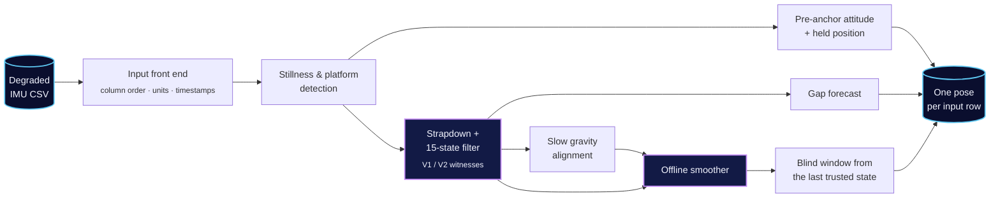

<div align="center">


<br>

<a href="https://research.samsung.com/"></a>
&nbsp;&nbsp;&nbsp;&nbsp;&nbsp;
<a href="https://www.samsungprism.com/"></a>

<h3>Samsung PRISM XR Hackathon Challenge 2026 · Track 3: Path Finder</h3>

<p><b>A drone's motion sensor is getting noisier, losing readings, and is about to die.<br>
Vortex rebuilds its full 6-DoF flight path from that sensor alone.</b></p>


<br><br>

<a href="https://www.youtube.com/watch?v=bPd4NMj70VY"></a>

<sub>▶ <a href="https://www.youtube.com/watch?v=bPd4NMj70VY"><b>Watch the 60-second film on YouTube</b></a> &nbsp;·&nbsp; <a href="assets/vortex-film.mp4">MP4 download (21 MB)</a></sub>

<br><br>

[**The problem**](#-the-problem) · [**How it works**](#-how-vortex-works) · [**Results**](#-results) · [**Budget**](#-inside-the-budget) · [**Run it**](#-run-it-in-60-seconds) · [**Deck**](Docs/deck/ManipalInstituteofTechnology_Vortex.pdf) · [**Team &amp; AI disclosure**](#-team-and-ai-disclosure)

</div>

---

## ✦ Vortex in 30 seconds

<table>
<tr>
<td width="33%" valign="top">

### 🛰️ The problem
No GPS, no camera: only a gyroscope and an accelerometer. Then the IMU degrades. Noise and bias grow, rows go missing, and in the last 5 s the sensor is dead. A pose is still needed for **every single row**.

</td>
<td width="33%" valign="top">

### 🧭 What Vortex does
A 15-state error-state Kalman filter with an offline smoother, kept in check by **velocity witnesses**: hints about motion from the IMU's own physics. It tracks how far it can trust the sensor, and when the sensor dies it holds on to the last state it trusted.

</td>
<td width="33%" valign="top">

### 📏 What we measured
On **36 held-out EuRoC flights** degraded with the organisers' own script, Vortex's trajectory error is **8.1% lower**, and its local-motion error **40.2% lower**, than a trajectory that never moves. It uses **6.60 ms** of compute per IMU-second (limit 20 ms) and **3,476 KB** of heap (limit 8,192 KB).

</td>
</tr>
</table>

> [!NOTE]
> **Held-out headline, shipped v1.0 build.** On 36 EuRoC copies (six flights × two column readings × seeds 4–6), Vortex scores **3.440 m** mean SE(3)-aligned APE against **3.745 m** for a never-moving trajectory scored the same way. It repeats on 36 more copies (seeds 7–9: **3.481 vs 3.748 m**) and on hand-held TUM-VI (**0.969 vs 1.137 m**). Every number on this page comes from the generated ledger [`Docs/NUMBERS.md`](Docs/NUMBERS.md).

---

## 🛰️ The problem

A flying platform has to keep track of itself with **no GPS and no camera**, using an IMU that gets steadily worse:

| Phase of the flight | What the sensor does | What Vortex has to do |
|:---|:---|:---|
| 🟢 **Healthy** | Clean gyro + accelerometer | Calibrate gravity, tilt and gyro bias; start tracking |
| 🟡 **Degrading** | Noise, bias and scale drift grow; spikes, stuck runs, duplicated rows | Keep integrating without letting small errors explode |
| 🟠 **Dropouts** | Rows physically **missing** | Carry the pose across the hole, with growing uncertainty |
| 🔴 **Blind 5 s** | Timestamps continue, values are dead (exact zeros) | Still output a pose for every row |

<details>
<summary><b>The exact rules we follow</b> (from the organisers' slides and FAQ, 17 Nov 2026)</summary>

<br>

| Input → output | Operating limits | Evaluation |
|---|---|---|
| EuRoC-format `imu0/data.csv` (gyro + accelerometer) → `timestamp tx ty tz qx qy qz qw`, one pose per input row, in order, never appended | Python only; offline (batch smoothing allowed); one thread; **8 MB peak at heap level**; **20 ms compute per second of IMU** | SE(3)-aligned ATE (evo) against hidden ground truth: 60 points for trajectory (waypoints 30, blind prediction 20, dropouts 10); 40 for efficiency (memory 20, runtime 20) |

The FAQ settled the open points: Python only (`main.py`); the 8 MB limit is measured at algorithm / heap level, not process RSS; non-causal smoothing is allowed; scoring uses SE(3) Umeyama alignment; dropouts are physically missing rows; and test data is any EuRoC or TUM-VI sequence degraded with the organisers' `degrade_imu.py`. How we handle every point the rules leave open is in [`Docs/SUBMISSION_RULES.md`](Docs/SUBMISSION_RULES.md).

</details>

**Why it's hard:** inertial navigation integrates acceleration twice, so a tiny tilt or bias error turns into metres of drift within seconds. Vortex gets no outside help to correct it. **No camera, GPS, barometer, ground truth or pretrained model enters the estimator.**

---

## 🧭 How Vortex works



1. **Read anything.** The front end detects IMU column order, timestamp scale and acceleration units from the file itself. It tolerates CRLF, missing headers, blank lines and extra columns.
2. **Calibrate while healthy.** Gravity, tilt and gyro bias come from a still interval, with a fallback if there isn't one. A whole-file accelerometer statistic decides whether this is a **drone** or a **hand-held** recording.
3. **Track with velocity witnesses.** A 15-state error-state Kalman filter runs on top of strapdown integration. Cues from the IMU's own physics keep velocity bounded (table below).
4. **Treat a gap as a gap.** Missing rows raise the filter's uncertainty; no rows are invented. Exact zero or stuck failures trigger a 0.5 s velocity-decay forecast.
5. **Smooth with hindsight.** The task is offline, so a forward-backward smoother revises earlier poses using later samples. When gyro noise rises, windowed gravity alignment steps in.
6. **Know when to stop believing.** If the file ends in ≥ 1 s of dead rows, every pose from 3 s before that run keeps the **attitude of the last trusted pose**, and its position is gently pulled toward the trajectory's centroid. Vortex stops trusting dead data instead of inventing motion.

| IMU-only cue | What it tells the filter | Shipped |
|:---|:---|:---:|
| **V1 · Stillness** | "I'm not moving": zero-velocity and gyro-bias updates | ✅ On |
| **V2 · Flight / hand-held envelope** | Speed and running-centre priors, chosen per platform, that keep drift bounded | ✅ On |
| **Slow gravity alignment** | Windowed tilt correction when the gyro gets noisy | ✅ On |

> [!TIP]
> **Every feature had to earn its place.** Each one is a switch, off by default. Its pass/fail rule was committed *before* it was compared on held-out data, and it ships only if it passes. Tuning used EuRoC MH_01/02 and TUM-VI rooms 1–2; every result below is on data the parameters never saw. The full record is in the [decision log](Docs/TRACK3_PLAN.md).

---

## 📊 Results

<div align="center">

</div>

**How it is scored.** Each run is compared with a **never-moving trajectory** on the *same input*, after the same per-run SE(3) Umeyama alignment the organisers use. [Scoring method](Docs/METHOD.md) · [source values and run tags](Docs/NUMBERS.md).

#### ✅ Highlights
- **5 of 6** held-out EuRoC flights beat the floor on full-trajectory error, in each column reading
- **7 of 8** clean EuRoC flights, and **4 of 4** TUM-VI rooms
- Local motion (1 s RPE) is **40–50% lower** on EuRoC
- Replicates on independent degradation seeds 7–9: **3.481 vs 3.748 m**
- Every output passes the format contract: **36/36** copies (seeds 4–6), **36/36** (seeds 7–9) and **24/24** TUM-VI

<details>
<summary><b>📋 Full results tables</b></summary>

<br>

| Test set · metric ↓ | Vortex | Never-moving floor | Relative error |
|---|---:|---:|---:|
| EuRoC held-out, seeds 4–6 · full APE (36 copies) | **3.440 m** | 3.745 m | **8.1% lower** |
| EuRoC held-out, seeds 4–6 · 1 s RPE | **0.562 m** | 0.941 m | **40.2% lower** |
| EuRoC held-out, seeds 4–6 · gap-window RMSE | **3.478 m** | 3.626 m | **4.1% lower** |
| EuRoC held-out, seeds 7–9 · full APE (36 further copies) | **3.481 m** | 3.748 m | **7.1% lower** |
| EuRoC held-out, seeds 7–9 · 1 s RPE | **0.563 m** | 0.943 m | **40.2% lower** |
| EuRoC clean · full APE (8 sequences) | **3.570 m** | 3.930 m | **9.2% lower** |
| EuRoC clean · 1 s RPE | **0.407 m** | 0.813 m | **49.9% lower** |
| TUM-VI held-out rooms 3–4 · full APE (12 copies) | **1.083 m** | 1.164 m | **7.0% lower** |
| TUM-VI held-out rooms 3–4 · 1 s RPE | **1.012 m** | 1.260 m | **19.7% lower** |
| TUM-VI rooms 1–4 · full APE (24 copies) | **0.969 m** | 1.137 m | **14.8% lower** |
| TUM-VI rooms 1–4 · gap-window RMSE | **0.988 m** | 1.078 m | **8.3% lower** |
| TUM-VI rooms 1–4, clean · full APE (4 sequences) | **0.879 m** | 1.137 m | **22.6% lower** |

**Both column readings.** The organisers' script can be fed IMU columns gyro-first (reading **a**, raw EuRoC order) or accelerometer-first (reading **b**). Vortex detects the order from the data, and both readings are scored (EuRoC held-out, seeds 4–6):

| Metric ↓ | Vortex a / floor | Vortex b / floor | a vs floor | b vs floor |
|---|---:|---:|---:|---:|
| Full APE | 3.506 / 3.745 m | 3.373 / 3.745 m | 6.4% lower | 9.9% lower |
| 1 s RPE | 0.606 / 0.941 m | 0.519 / 0.941 m | 35.5% lower | 44.9% lower |

**Held-out discipline.** Parameters were tuned on EuRoC MH_01/02 and TUM-VI rooms 1–2 only. MH_03–05, V1_01–03 and TUM-VI rooms 3–4 were held out, and each feature's decision rule was committed before it was judged on them. On TUM-VI the platform detector selects the hand-held envelope automatically. Ground truth is used only for scoring.

[Verified figures](Docs/NUMBERS.md) · [generated results](Docs/RESULTS.md) · [decision log](Docs/TRACK3_PLAN.md)

</details>

---

## ⚡ Inside the budget

<div align="center">

</div>

<details>
<summary><b>📋 Budget details</b></summary>

<br>

Every figure is for the shipped `src/main.py`, compiled from source (no bytecode ships), on the zip's evaluation input `MH_03_medium_b_s1` (reading b, 26,106 rows). Heap values are tracemalloc peaks for the whole run, started before the file is compiled. [Budget record](Docs/BUDGET.md) · [Docker benchmark](Docs/DOCKER_BENCH.md) · [clean-machine check](Docs/CLEAN_MACHINE.md).

| Parameter | Measured | Limit | Headroom |
|---|---:|---:|---|
| Wall time per IMU second, Linux Docker (`python:3.12.7-slim-bookworm`, 15-run median) | **6.60 ms** | 20 ms | 67% below; 6.56–7.67 ms over seven inputs |
| Wall time per IMU second, Windows 11, Python 3.14.7 | **5.82 ms** | 20 ms | 71% below |
| Time per row, Windows 11, Python 3.14.7 | **30.1 µs** | — | — |
| Whole-run heap from source, Python 3.14.7 | **3,476 KB** | 8,192 KB | 4,716 KB below |
| Whole-run heap from source, Python 3.13.5 | **4,158 KB** | 8,192 KB | 4,034 KB below |
| Automated tests, Windows 11, Python 3.14.7, 22 Nov | **521 passed** | — | 0 failed |

</details>

---

## 🚀 Run it in 60 seconds

The submission is **one self-contained file**, `src/main.py`: pure Python 3, standard library only, single thread, offline and deterministic. It never crashes on a readable input.

```bash
python -S src/main.py                              # finds imu0/data.csv (or data.csv) here, writes estimated_trajectory.txt
python -S src/main.py IN                           # IN: the csv, or a sequence folder
python -S src/main.py IN OUT                       # OUT: the trajectory file, or a folder
python -S src/main.py --input IN --output OUT      # also -i IN -o OUT
```

**With Docker:**

```bash
docker build -t vortex .
docker run --rm -v "<folder with the csv>:/data" -w /data vortex
```

**From this repository** (no dataset needed: a synthetic file checks the format and the output contract, not navigation accuracy):

```bash
python -m pip install -e '.[dev]' && pytest
python tools/synth_euroc.py imu.csv --rows 36000 --seed 0
python -S main.py imu.csv estimated_trajectory.txt
python -m vortex.check_output imu.csv estimated_trajectory.txt     # → PASS: 36000 input rows, 36000 output rows
```

<details>
<summary><b>📦 The submission file, failure behaviour and Docker</b></summary>

<br>

`src/main.py` is **generated** from [`pathfinder.py`](pathfinder.py) by [`tools/make_bundle.py`](tools/make_bundle.py) and never edited by hand. It holds `pathfinder.py` verbatim as source text under a short loader that compiles it one function at a time. That keeps the whole run between 3,476 KB (Python 3.14.7) and 4,158 KB (3.13.5) of heap; compiling the full file in one go would use most of the 8 MB budget. Error messages keep `pathfinder.py`'s line numbers. The output is byte-identical to the repository's `python -S main.py`. This was checked on all 412 copies (official EuRoC and TUM-VI degraded copies plus clean sequences) when the layout was chosen, and again for v1.0. The output is also identical on CPython 3.12, 3.13 and 3.14.

Every invocation works with or without `-S`, under `-I`, and from any working directory. A folder (or the current folder, with no `IN`) is searched for `imu0/data.csv`, `mav0/imu0/data.csv`, `data.csv`, then a single `*.csv`. The output has one line `timestamp tx ty tz qx qy qz qw` per input data row, in input order. Timestamps are the input nanoseconds with the decimal point moved by integer arithmetic, so they are exact.

**Never crashes on a readable input.** If the estimator raises any exception (`MemoryError` included), `main.py` writes a note on stderr, writes a constant pose (origin, identity attitude) for every input row with the exact timestamps, and exits 0. If the estimator cannot even be loaded, the loader does the same. Otherwise the exit codes are 2 for wrong arguments or no input found, and 1 if the input cannot be read or the output cannot be written.

**Docker.** The repository [`Dockerfile`](Dockerfile) builds the same single file from `pathfinder.py` in a first stage and runs only that file (`python -S /app/main.py` on `python:3.12.7-slim-bookworm`). The zip carries its own [Dockerfile](bundle/Dockerfile) that copies the shipped `src/main.py`. On 22 Nov the image's `/app/main.py` was byte-identical to the zip's `src/main.py`, and both `docker run` forms reproduced the zip's `estimated_trajectory.txt` byte for byte.

```bash
docker run --rm -v "<folder with the csv>:/data" vortex /data/data.csv /data/estimated_trajectory.txt
```

**v1.0 bundle.** Tag `v1.0`, `dist/vortex_v1.0.zip`, sha256 `e251c4010248caf5103bbf2923122146bba64ae7e2b225069a89672ffbd4447c`. It passed `verify` on Windows/Python 3.14.7 and 3.13.5 and on WSL2/Python 3.12.3. Its `estimated_trajectory.txt` is our output for the official degraded copy `MH_03_medium_b_s1` (26,106 rows). The bundle README and `metadata.json` name the input and the commit. [Bundle guide](bundle/README.md).

</details>

<details>
<summary><b>🛠️ Build the bundle, score real data, reproduce the results</b></summary>

<br>

`main.py` (a stub that runs `pathfinder.py`) and `pathfinder.py` use the standard library only; the analysis tools and tests need the dependencies in `pyproject.toml`. Run everything from the repository root. The budget figures are for the submission file, `src/main.py`.

**Build and verify the submission zip** (pass absolute paths to `--dir`):

```bash
python tools/make_bundle.py stage --dir "$PWD/dist/stage"
python tools/make_bundle.py same --dir "$PWD/dist/stage"                   # byte-identity against `python -S main.py`
python tools/make_bundle.py eval IMU.csv --dir "$PWD/dist/stage"           # estimated_trajectory.txt + metadata.json
python tools/make_bundle.py zip --name Vortex --dir "$PWD/dist/stage" --out "$PWD/dist"
python tools/make_bundle.py verify "$PWD/dist/Vortex.zip"
```

**Score a real EuRoC sequence.** Data and ground truth are not shipped; see [data setup](Docs/DATA.md).

```bash
python -S main.py data/euroc/MH_01_easy/mav0/imu0/data.csv estimated_trajectory.txt
python -m vortex.check_output data/euroc/MH_01_easy/mav0/imu0/data.csv estimated_trajectory.txt
python score.py --gt data/euroc/MH_01_easy --est estimated_trajectory.txt
python tools/eval_euroc.py --tag local-clean --seqs MH_01_easy,MH_02_easy,MH_03_medium   # rebuilds Docs/RESULTS.md
```

The official-copy scores need the organisers' `degrade_imu.py` and the datasets locally (neither is committed). `python -m vortex.degrade` is the project's own fault model for workflow checks.

**Regenerate this README's charts** from `Docs/NUMBERS.md`:

```bash
python tools/readme_figures.py           # assets/readme-results.svg, assets/readme-budget.svg
python tools/readme_figures.py --check   # fails if they are out of date
```

</details>

---

## 🔬 Deep dive

<details>
<summary><b>🎛️ Every switch in the shipped estimator</b></summary>

<br>

Every `*_ON` assignment in the shipped [`pathfinder.py`](pathfinder.py) is **on**, and each passed its registered rule before shipping.

| Switch | What it does | Record |
|---|---|---|
| `FRONT_ON` | Input format detection | [Step 2](Docs/TRACK3_PLAN.md) |
| `CAL_NOISE_ON` | Noise-tolerant still-calibration fallback | [Step 6e](Docs/TRACK3_PLAN.md) |
| `BGCAP_ON` | Caps false stillness during steady rotation | [Step F](Docs/TRACK3_PLAN.md) |
| `P0V_ON` | Wider initial velocity uncertainty without an anchor | [Step F](Docs/TRACK3_PLAN.md) |
| `REFRESH_ON` | Refreshes the cached sample after a correction | [Step F](Docs/TRACK3_PLAN.md) |
| `SMOOTH_ON` | Offline forward-backward smoother | [Step 6](Docs/TRACK3_PLAN.md) |
| `PLATFORM_ON` | Hand-held vs multirotor detection; selects the envelope | [Step 7](Docs/TRACK3_PLAN.md) |
| `TILT_ON` | Gravity alignment when the gyro is noisy | [Step L2](Docs/TRACK3_PLAN.md) |
| `TILT_LAG` | Lag model of that gravity alignment | [Step L2](Docs/TRACK3_PLAN.md) |
| `BLIND_ON` | Blind window from the last trusted state | [Step L3](Docs/TRACK3_PLAN.md) |
| `BLIND_DEAD_ONLY` | Acts only on a detected trailing dead run | [Step L3](Docs/TRACK3_PLAN.md) |
| `V1_ON` | Stillness witness | [Step 7a](Docs/TRACK3_PLAN.md) |
| `V2_ON` | Speed prior | [Step 7a](Docs/TRACK3_PLAN.md) |
| `V2P_ON` | Running-centre position prior | [Step 7a](Docs/TRACK3_PLAN.md) |
| `GAP_ON` | Dropout covariance | [Step 6c](Docs/TRACK3_PLAN.md) |
| `DEAD_ON` | Exact zero / stuck failure detection | [Step 8a](Docs/TRACK3_PLAN.md) |
| `FC_ON` | Velocity decay during gaps and the blind phase | [Step 8a](Docs/TRACK3_PLAN.md) |

Candidates that did not pass their rule stay switched off in the [reference filter](vortex/core/witness.py) and are not part of the submission.

</details>

<details>
<summary><b>🗺️ Repository map</b></summary>

<br>

| Path | What's there |
|---|---|
| [`pathfinder.py`](pathfinder.py) | The estimator: standard library only, the source of the shipped `src/main.py` |
| [`main.py`](main.py) | Repository entry point (a stub that runs `pathfinder.py`) |
| [`bundle/`](bundle/README.md) | README and Dockerfile that ship inside the submission zip |
| [`vortex/`](vortex) | Reference filter (`core/`), metrics, scoring, output checker, fault model |
| [`tools/`](tools) | Bundle builder, evaluators, judging scripts for each registered rule, benchmarks, chart generator |
| [`tests/`](tests) | pytest suite (521 passed on 22 Nov) |
| [`Docs/`](Docs) | Plan, generated numbers and results, budget, method, studies, deck |
| [`score.py`](score.py), [`benchmark.py`](benchmark.py) | SE(3)-aligned scorer; runtime and heap gate |
| `main.cpp`, `Dockerfile.ccore` | A C++ port kept as a speed experiment; not part of the Python submission |

</details>

<details>
<summary><b>📚 Documentation</b></summary>

<br>

- [Project deck](Docs/deck/ManipalInstituteofTechnology_Vortex.pdf) ([PowerPoint](Docs/deck/ManipalInstituteofTechnology_Vortex.pptx))
- [Decision log](Docs/TRACK3_PLAN.md): every registered rule and its verdict
- [Verified figures](Docs/NUMBERS.md): every quotable number, with source tags
- [Generated results](Docs/RESULTS.md): clean and degraded EuRoC metrics, stationary floor, ablations
- [Method](Docs/METHOD.md): test-set composition and metric definitions
- [Official-script baseline](Docs/STEP2_BASELINE.md) and [TUM-VI baseline](Docs/TUMVI_BASELINE.md)
- [Budget ledger](Docs/BUDGET.md), [efficiency floor](Docs/FLOOR.md), [Docker benchmark](Docs/DOCKER_BENCH.md), [clean-machine check](Docs/CLEAN_MACHINE.md)
- [Scorer cross-check](Docs/EVO_CROSSCHECK.md): our scorer against evo on synthetic trajectories
- [Submission rules](Docs/SUBMISSION_RULES.md), [data instructions](Docs/DATA.md) and [third-party notices](THIRD_PARTY.md)

</details>

---

## 🤝 Team and AI disclosure

**Vortex is the work of Arnav Jain**, solo entrant, Manipal Institute of Technology.

Arnav conceived the project and owned every decision in it:
- **Approach:** chose the velocity-witness design and the IMU-only, no-pretrained-model constraint.
- **Rules:** set the rules every change had to follow. Features are switches that are off by default. Pass/fail rules are committed before held-out data is touched. Ground truth is used only for scoring, and every number comes from a generated ledger.
- **Testing:** decided which data was for tuning and which was held out, and ran the datasets and the test suite on his own machine.
- **Oversight:** planned and assigned every task, reviewed each one, and approved and merged every change into this repository.
- **Film:** chose the film's story and directed its production.

AI tools assisted under that direction, and Arnav oversaw each and every task they took on:

| Tool | How it helped |
|---|---|
| **Claude** (Anthropic), via Claude Code | Implementation of estimator code, tests, evaluation scripts and documentation. Each piece followed a written task from Arnav and was merged only after his review |
| **Gemini**, in Google Antigravity | Dataset preparation, benchmark and Docker runs, clean-machine verification and demo footage |
| **ChatGPT** (OpenAI) | Technical review and drafting for the deck and script |
| **Google Flow** | AI animation for the film |
| **ElevenLabs** | AI voice for the film |
| **Claude** | Writing support for the film |

Every approach, decision rule and ship decision was Arnav's call.

---

<div align="center">

**Built by Arnav Jain** · Manipal Institute of Technology · Submission name `VORTEX` (solo entry)

<sub>Code: [MIT](LICENSE). Samsung Research and Samsung PRISM marks identify the challenge context and are Samsung's; the [Research mark](https://cdn.codeground.org/nsr/images/layout/logo-sr.png) and [PRISM mark](https://www.samsungprism.com/assets/images/prism_logo.png) are reproduced from their official sites.</sub>

</div>
