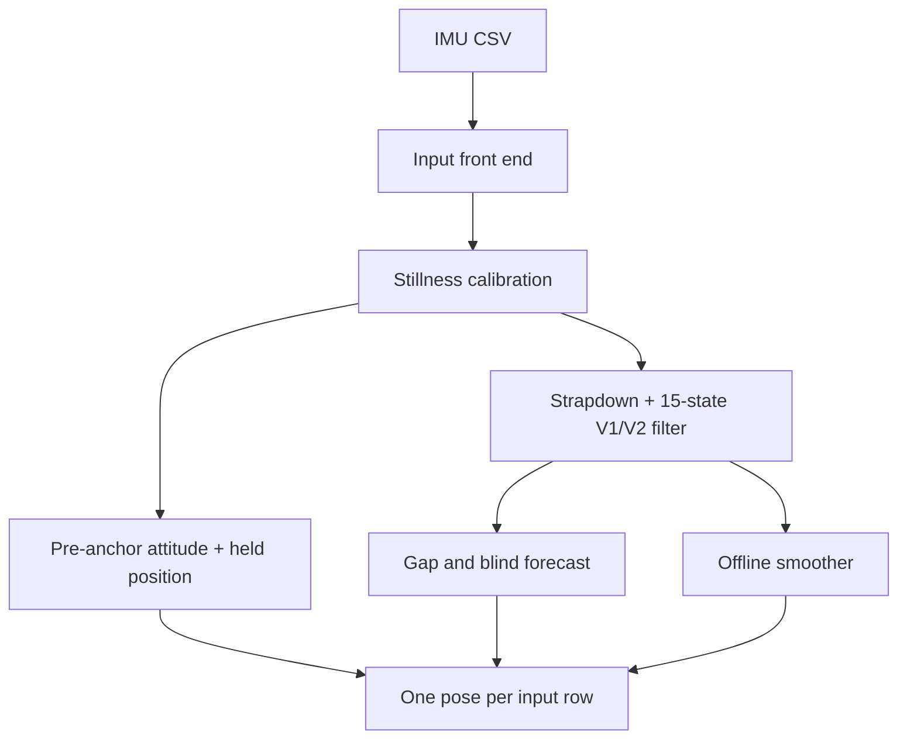

<div align="center">


<br>

<a href="https://research.samsung.com/"></a>
&nbsp;&nbsp;&nbsp;&nbsp;&nbsp;
<a href="https://www.samsungprism.com/"></a>

<p><strong>Samsung PRISM XR Hackathon Challenge 2026 · Track 3: Path Finder</strong></p>
<p>IMU-only, 6-DoF trajectory estimation under sensor degradation.</p>

[Challenge](#the-challenge) · [Architecture](#architecture) · [Measured results](#measured-results) · [Run](#run-vortex) · [Research notes](#research-notes)

</div>

---

> **Official-script held-out result:** Across both EuRoC column readings, Vortex remains worse than a never-moving trajectory: **4.648 vs 3.745 m** mean SE(3) APE. Reading **b** beats that floor by **6.2%** (3.515 vs 3.745 m), but reading **a** is **54.4% worse** (5.782 vs 3.745 m) and the blind 5 s is **201.8% worse** (7.559 vs 2.504 m). The earlier TUM-VI baseline, before the smoother, is also worse: **2.599 vs 1.164 m** on held-out rooms 3–4. [Recorded results](Docs/RESULTS.md) · [TUM-VI baseline](Docs/TUMVI_BASELINE.md) · [decision log](Docs/TRACK3_PLAN.md).

## The challenge

An aircraft must navigate without GPS or cameras while its IMU becomes less reliable: noise and bias grow, readings disappear for up to two seconds, and the sensor eventually fails. The task is to reconstruct a **6-DoF pose for every input IMU row**, including the five seconds after failure, from a EuRoC-format `imu0/data.csv` alone. The evaluator uses EuRoC MAV and TUM-VI sequences with hidden ground truth.

| Input → output | Operating limits | Evaluation |
|---|---|---|
| Gyroscope + accelerometer → `timestamp tx ty tz qx qy qz qw`; one pose per input row, in order, never appended | Python only; offline (batch smoothing allowed), one thread; **8 MB peak at heap level** and **20 ms compute per second of IMU** | SE(3)-aligned ATE (evo) against hidden ground truth: 60 points for trajectory (waypoints 30, blind prediction 20, dropouts 10); 40 for efficiency (memory 20, runtime 20) |

The organisers' FAQ (17 Nov 2026) settled the open points: Python only (`main.py`; `main.cpp` is not accepted), the 8 MB limit is measured at algorithm / heap level rather than process RSS, non-causal smoothing is allowed, scoring uses SE(3) Umeyama alignment, dropouts are physically missing rows, and test data is any EuRoC or TUM-VI sequence degraded with their `degrade_imu.py`.

Small attitude and bias errors grow rapidly under inertial integration. Vortex uses two IMU-only velocity witnesses: **V1 stillness** and **V2 flight envelope**. V2 pulls velocity towards zero and position towards a running centre of the estimate; it bounds drift but is a prior, **not an independent motion measurement**. No camera, GPS, barometer, ground truth or pretrained model enters the estimator.

## Architecture

**Shipped Python path:**



`main.py` launches the standard-library estimator in [`pathfinder.py`](pathfinder.py). The **input front end** detects IMU column order, timestamp scale and acceleration units from the file, canonicalising non-standard input beside the output. It handled the eight clean sequences and 64 official-script copies in the [Step 2 record](Docs/TRACK3_PLAN.md); degrees/second versus fast radians/second motion cannot be resolved automatically. The estimator calibrates gravity, tilt and gyro bias on a still interval, holds pre-anchor position, and then runs a 15-state error-state Kalman filter. Missing rows increase uncertainty; exact zero/stuck failures and invalid samples trigger a 0.5 s velocity-decay forecast. Step F adds a gyro-bias cap, fallback velocity uncertainty and cached-sample refresh. Step 6's offline forward-backward smoother refines earlier poses using later IMU samples; the final blind state has no future observation.

| IMU-only cue | Role | Shipped state |
|---|---|---|
| V1 · Stillness | Zero-velocity and gyro-bias updates | **On**; little in-flight rest on MH |
| V2 · Flight envelope | Speed and running-centre position priors | **On**; bounds drift but can flatten real motion |
| V3 · Rotor drag | Proposed in-flight velocity cue | **Not built**; both registered signal rules returned NO-GO |
| Turn physics, walking rhythm, tilt response | Conditional research ideas | Not shipped |

The [reference filter](vortex/core/witness.py) retains rejected experiments. Presence in source does not mean a feature is enabled.

### Switches

Shipped `*_ON` assignments in `pathfinder.py` at `d1fc504`; rejected experiment switches below live only in the reference or `tools/pathfinder_lab.py`:

| Switch | State | Reason and record |
|---|---|---|
| `FRONT_ON` | **On** | Input format detection; [Step 2](Docs/TRACK3_PLAN.md). |
| `CAL_NOISE_ON` | **On** | Noise-tolerant still calibration fallback; [Step 6e](Docs/TRACK3_PLAN.md). |
| `BGCAP_ON` | **On** | Caps false stillness during steady rotation; [Step F](Docs/TRACK3_PLAN.md). |
| `P0V_ON` | **On** | Wider initial velocity uncertainty without an anchor; [Step F](Docs/TRACK3_PLAN.md). |
| `REFRESH_ON` | **On** | Refreshes cached sample after correction; [Step F](Docs/TRACK3_PLAN.md). |
| `SMOOTH_ON` | **On** | Offline forward-backward correction passed the registered held-out rule; [Step 6](Docs/TRACK3_PLAN.md). |
| `V1_ON` | **On** | Stillness witness; [Step 7a](Docs/TRACK3_PLAN.md). |
| `V2_ON` | **On** | Speed prior; [Step 7a](Docs/TRACK3_PLAN.md). |
| `V2P_ON` | **On** | Running-centre position prior; [Step 7a](Docs/TRACK3_PLAN.md). |
| `GAP_ON` | **On** | Dropout covariance; [Step 6c](Docs/TRACK3_PLAN.md). |
| `DEAD_ON` | **On** | Exact zero/stuck failure detection; [Step 8a](Docs/TRACK3_PLAN.md). |
| `FC_ON` | **On** | Velocity decay during gaps and blind phase; [Step 8a](Docs/TRACK3_PLAN.md). |
| `JAM_ON` | **Off (lab only)** | Noise meter failed its rule on the project's placeholder fault model; it was not judged on the official script. [Step 6c](Docs/TRACK3_PLAN.md). |
| `RESET_ON` | **Off (lab only)** | Covariance reset worsened held-out APE; [Step F](Docs/TRACK3_PLAN.md). |
| `LEARN_ON` | **Off (lab only)** | Per-flight envelope tied the degraded floor but raised clean APE; [Step 4](Docs/TRACK3_PLAN.md). |
| `FF_STUCK6_ON` | **Off (lab only)** | Stuck-row rejection failed held-out checks; [Step 3](Docs/TRACK3_PLAN.md). |
| `FF_SPIKE_ON` | **Off (lab only)** | Spike rejection did not improve held-out APE; [Step 3](Docs/TRACK3_PLAN.md). |
| `INTERP_ON` | **Off (lab only)** | Interpolation worsened aggregate and reading-a scores; [Step 3](Docs/TRACK3_PLAN.md). |
| `SHRINK_ON` | **Off (lab only)** | Both shrinkage arms failed registered conditions before the smoother shipped; [Step L1](Docs/TRACK3_PLAN.md). |

Denoised V1 remains **off in the reference only**. An experimental per-row sigma did not rank error and is not submitted as calibrated confidence ([coverage study](Docs/COVERAGE.md)).

## Measured results

**Primary scoreboard — Step 6 shipped build, organisers' degradation script, held-out MH_03–05 and V1_01–03, readings a and b, seeds 4–6 (36 copies).** APE is the mean per-copy translational RMSE after SE(3) alignment fitted on each run. Reading **a** feeds raw gyro-first EuRoC columns to the script; reading **b** feeds accelerometer columns first. The actual evaluator order (Q9) remains unknown. [Step 6](Docs/TRACK3_PLAN.md) · [generated results](Docs/RESULTS.md).

| Held-out input | Vortex APE ↓ | Never-moving APE ↓ | Blind 5 s RMSE: Vortex / floor ↓ |
|---|---:|---:|---:|
| Reading a · 18 copies | **5.782 m** | **3.745 m** | 11.756 / 2.504 m |
| Reading b · 18 copies | **3.515 m** | **3.745 m** | 3.363 / 2.504 m |
| **Both · 36 copies** | **4.648 m** | **3.745 m** | **7.559 / 2.504 m** |

**Vortex does not beat standing still overall on the official degradation.** Reading b is 6.2% better on aggregate APE (four of six sequences beat the floor), while reading a is 54.4% worse and blind 5 s RMSE is 201.8% worse. The input front end recognises the order, but it cannot undo accelerometer-sized faults applied to gyro columns under reading a. Ground truth is used only for scoring.

On eight clean EuRoC sequences, the Step 6 build recorded **3.555 m** mean SE(3) APE versus **3.930 m** for never-moving. V2 is a prior rather than a measurement of velocity; the smoother uses later IMU samples, not an external motion cue. Results from the project's own placeholder fault injector are historical workflow evidence and **not a proxy for the organisers' script**. [Clean results](Docs/RESULTS.md) · [Step 6](Docs/TRACK3_PLAN.md).

**A negative control:** Before the smoother shipped, Step L1 trust-scaled shrinkage improved its aggregate objective but failed the registered sequence-consistency check; its time-reversed output scored better. Shrinking an estimate can improve SE(3)-aligned scores without demonstrating motion information. **`SHRINK_ON` remains off** and was not re-judged with the smoother. [Step L1](Docs/TRACK3_PLAN.md) · [Step 6](Docs/TRACK3_PLAN.md).

**TUM-VI baseline (before Step 6 smoothing):** on held-out rooms 3–4, both readings and seeds 1–3, Vortex recorded **2.599 m** APE versus **1.164 m** for never-moving; blind 5 s RMSE was **6.404 vs 0.741 m**. Clean rooms 1–6 recorded **0.997 vs 1.077 m**. Stillness calibration did not fire on any of the six clean rooms or 24 official copies (`fallback_zero`). These are the recorded pre-smoother results, not a claim for the current shipped build. [TUM-VI baseline](Docs/TUMVI_BASELINE.md) · [table generator](tools/tumvi_table.py).

| Other recorded check | Outcome |
|---|---|
| Automated tests | **335 passed**, Windows/Python 3.14.7, 18 Nov; recorded, not rerun for this documentation change ([numbers](Docs/NUMBERS.md)) |
| Latest official-copy budget | **5.89 ms per IMU-second** wall time; **1,796 KB** traced whole-run heap with matching bytecode, **5,580 KB** without, Windows/Python 3.14.7 ([budget](Docs/BUDGET.md)) |
| V3 rotor drag | Revised rule returned NO-GO on Vicon Room 1; V3 **not built** ([Step 5](Docs/TRACK3_PLAN.md)) |
| Per-row confidence | Reference sigma did not rank error on MH_01/02 tuning data; no calibrated confidence claimed ([coverage](Docs/COVERAGE.md)) |
| Submission bundle | Python-only launcher, estimator, version-matched bytecode, Dockerfile and manifest ([guide](bundle/README.md)) |

The recorded 20 ms/IMU-second and 8 MB **heap** gates pass on the measured machine. Whole-process RSS includes the interpreter and is not the organisers' memory metric. Without matching bytecode, compilation raises the traced heap; the latest 3.13 no-cache reading on synthetic input is **6,309 KB**, still under 8 MB ([budget](Docs/BUDGET.md)). TUM-VI has a pre-smoother baseline above; the current build has not been evaluated there. Untouched Vicon Room 2 remains the final test. L2 slow gravity alignment, L3 blind-window start state and submission hardening remain planned ([plan](Docs/TRACK3_PLAN.md)).

## Run Vortex

Python 3.12 is sufficient for the submission entry point; `main.py` and `pathfinder.py` use the standard library. Analysis and tests need the dependencies in `pyproject.toml`. Run these commands from the repository root.

```bash
python -m pip install -e '.[dev]'
pytest

# Synthetic format and output-contract check, not a navigation benchmark.
python tools/synth_euroc.py imu.csv --rows 36000 --seed 0
python -S main.py imu.csv estimated_trajectory.txt
python -m vortex.check_output imu.csv estimated_trajectory.txt
```

The checker should report `PASS: 36000 input rows, 36000 output rows`. `python -S` skips site-package initialisation for the standard-library launcher; it does **not** provide a matching cached bytecode file. A source-only checkout still runs but incurs a higher compilation heap peak.

For the [submission bundle](bundle/README.md), run `python tools/make_bundle.py stage` under each target Python version, then `python tools/make_bundle.py zip --name NAME` and `python tools/make_bundle.py verify dist/NAME.zip`. Replace `NAME` with the submission name when known. Verification runs under the current interpreter. The bundle includes a [Dockerfile](bundle/Dockerfile).

EuRoC data and ground truth are **not shipped**. With a locally downloaded sequence under `data/euroc/` ([data setup](Docs/DATA.md)):

```bash
python -S main.py data/euroc/MH_01_easy/mav0/imu0/data.csv estimated_trajectory.txt
python -m vortex.check_output data/euroc/MH_01_easy/mav0/imu0/data.csv estimated_trajectory.txt
python score.py --gt data/euroc/MH_01_easy --est estimated_trajectory.txt
```

The clean-data evaluator also requires local sequences and ground truth; its tag writes JSON and rebuilds `Docs/RESULTS.md`:

```bash
python tools/eval_euroc.py --tag local-clean --seqs MH_01_easy,MH_02_easy,MH_03_medium,MH_04_difficult,MH_05_difficult
```

This is a **project-placeholder fault model**, useful for a workflow check but not interchangeable with the organisers' `degrade_imu.py`:

```bash
python -m vortex.degrade data/euroc/MH_01_easy data/degraded/MH_01_easy_s1 --seed 1
python tools/eval_euroc.py --tag local-placeholder --degraded --seqs MH_01_easy_s1
```

The official script and FAQ files are not committed. The [official baseline](Docs/STEP2_BASELINE.md), [generated results](Docs/RESULTS.md) and [plan](Docs/TRACK3_PLAN.md) record both column readings; reproducing their official-copy scores requires that local script and data.

## Research notes

- [Track 3 plan](Docs/TRACK3_PLAN.md) — registered decisions, open Q9 and next steps.
- [Official-script baseline](Docs/STEP2_BASELINE.md) — original held-out floor comparison.
- [TUM-VI baseline](Docs/TUMVI_BASELINE.md) — held-out rooms, floor comparison and calibration coverage before the smoother.
- [Generated results](Docs/RESULTS.md) — clean and seeded degraded EuRoC metrics, stationary floor, and ablations.
- [Blind-window study](Docs/BLIND.md) — dead-sensor detection and five-second forecast comparisons.
- [Confidence coverage](Docs/COVERAGE.md) — why the experimental per-row sigma is not reported as calibrated confidence.
- [Submission bundle](bundle/README.md) — launcher, bytecode, manifest, Docker, and verification.
- [Budget ledger](Docs/BUDGET.md) and [efficiency floor](Docs/FLOOR.md) — synthetic and real timing, heap and process memory, and interpreter cost.
- [Rotor-drag study](Docs/DRAG.md) — pre-registered NO-GO result and explicitly labeled exploratory fits.
- [Scorer cross-check](Docs/EVO_CROSSCHECK.md) — evo comparison on synthetic trajectories.
- [Data instructions](Docs/DATA.md) and [third-party notices](THIRD_PARTY.md) — datasets stay outside the repository.

**Current solo entrant:** Arnav Jain · **Submission name:** `[TEAM_NAME]` · **College:** `[COLLEGE_NAME]`. Samsung Research and Samsung PRISM marks identify the challenge context; Vortex is Arnav's current solo entry.

<sub>Project code: [MIT](LICENSE). Brand marks are Samsung's; [Research mark](https://cdn.codeground.org/nsr/images/layout/logo-sr.png) and [PRISM mark](https://www.samsungprism.com/assets/images/prism_logo.png) are reproduced from their official sites.</sub>
