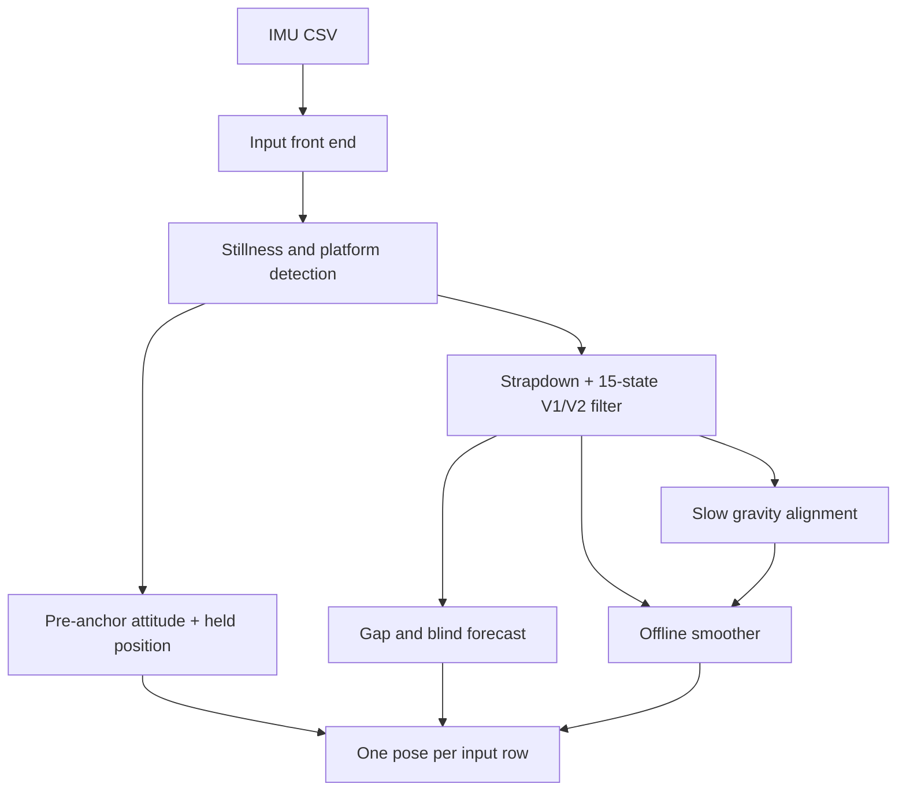

<div align="center">


<br>

<a href="https://research.samsung.com/"></a>
&nbsp;&nbsp;&nbsp;&nbsp;&nbsp;
<a href="https://www.samsungprism.com/"></a>

<p><strong>Samsung PRISM XR Hackathon Challenge 2026 · Track 3: Path Finder</strong></p>
<p>IMU-only, 6-DoF trajectory estimation under sensor degradation.</p>

[Challenge](#the-challenge) · [Architecture](#architecture) · [Comparisons](#where-vortex-is-better) · [Measured results](#measured-results) · [Run](#run-vortex) · [Research notes](#research-notes)

</div>

---

> **Official-script held-out result:** On 36 EuRoC copies (six sequences, two column readings, seeds 4–6), Vortex records **3.480 m** mean SE(3)-aligned APE versus **3.745 m** for a never-moving trajectory: **7.1% lower**. Reading **a** is **3.539 vs 3.745 m**, reading **b** **3.421 vs 3.745 m**. The blind five seconds remain **worse**: **3.017 vs 2.504 m**. These are results on these held-out copies, not a guarantee on hidden data. [Verified figures](Docs/NUMBERS.md) · [results](Docs/RESULTS.md) · [decision log](Docs/TRACK3_PLAN.md).

## The challenge

An aircraft must navigate without GPS or cameras while its IMU becomes less reliable: noise and bias grow, readings disappear for up to two seconds, and the sensor eventually fails. The task is to reconstruct a **6-DoF pose for every input IMU row**, including the five seconds after failure, from a EuRoC-format `imu0/data.csv` alone. The evaluator uses EuRoC MAV and TUM-VI sequences with hidden ground truth.

| Input → output | Operating limits | Evaluation |
|---|---|---|
| Gyroscope + accelerometer → `timestamp tx ty tz qx qy qz qw`; one pose per input row, in order, never appended | Python only; offline (batch smoothing allowed), one thread; **8 MB peak at heap level** and **20 ms compute per second of IMU** | SE(3)-aligned ATE (evo) against hidden ground truth: 60 points for trajectory (waypoints 30, blind prediction 20, dropouts 10); 40 for efficiency (memory 20, runtime 20) |

The organisers' FAQ (17 Nov 2026) settled the open points: Python only (`main.py`; `main.cpp` is not accepted), the 8 MB limit is measured at algorithm / heap level rather than process RSS, non-causal smoothing is allowed, scoring uses SE(3) Umeyama alignment, dropouts are physically missing rows, and test data is any EuRoC or TUM-VI sequence degraded with their `degrade_imu.py`.

Small attitude and bias errors grow rapidly under inertial integration. Vortex uses IMU-only cues: **V1 stillness**, **V2 speed and running-centre priors**, a platform-specific envelope for hand-held TUM-VI input, and slow gravity alignment when gyro noise is high. V2 bounds drift but is a prior, **not an independent motion measurement**. No camera, GPS, barometer, ground truth or pretrained model enters the estimator.

## Architecture

**Shipped Python path:**



`main.py` launches the standard-library estimator in [`pathfinder.py`](pathfinder.py). The **input front end** detects IMU column order, timestamp scale and acceleration units from the file; degrees/second versus fast radians/second motion cannot always be resolved automatically. The estimator calibrates gravity, tilt and gyro bias on a still interval (or falls back), holds pre-anchor position, and runs a 15-state error-state Kalman filter. A whole-file accelerometer statistic selects the drone or hand-held envelope. Missing rows increase uncertainty; exact zero/stuck failures and invalid samples trigger a 0.5 s velocity-decay forecast. A gyro noise meter activates windowed gravity alignment when needed. Step F caps gyro bias, widens fallback velocity uncertainty and refreshes cached samples; the offline smoother revises earlier poses from later IMU samples. The final blind state has no future observation.

| IMU-only cue | Role | Shipped state |
|---|---|---|
| V1 · Stillness | Zero-velocity and gyro-bias updates | **On**; little in-flight rest on MH, no detected stillness on the measured TUM-VI rooms |
| V2 · Flight / hand-held envelope | Speed and running-centre position priors selected by platform | **On**; bounds drift but can flatten real motion |
| Slow gravity alignment | Windowed correction when gyro noise rises | **On**; Step L2 passed its revised rule on held-out copies |
| V3 · Rotor drag | Proposed in-flight velocity cue | **Not built**; both registered signal rules returned NO-GO |
| Turn physics, walking rhythm | Conditional research ideas | Not shipped |

The [reference filter](vortex/core/witness.py) retains rejected experiments. Presence in source does not mean a feature is enabled.

### Switches

Every `*_ON` assignment in the shipped [`pathfinder.py`](pathfinder.py) on the current main branch is **on**. Rejected alternatives live in the reference or lab copy, not in this switch list:

| Switch | State | Reason and record |
|---|---|---|
| `FRONT_ON` | **On** | Input format detection; [Step 2](Docs/TRACK3_PLAN.md). |
| `CAL_NOISE_ON` | **On** | Noise-tolerant still calibration fallback; [Step 6e](Docs/TRACK3_PLAN.md). |
| `BGCAP_ON` | **On** | Caps false stillness during steady rotation; [Step F](Docs/TRACK3_PLAN.md). |
| `P0V_ON` | **On** | Wider initial velocity uncertainty without an anchor; [Step F](Docs/TRACK3_PLAN.md). |
| `REFRESH_ON` | **On** | Refreshes cached sample after correction; [Step F](Docs/TRACK3_PLAN.md). |
| `SMOOTH_ON` | **On** | Offline forward-backward correction passed the registered held-out rule; [Step 6](Docs/TRACK3_PLAN.md). |
| `PLATFORM_ON` | **On** | Detects hand-held versus multirotor input and selects the envelope; [Step 7](Docs/TRACK3_PLAN.md). |
| `TILT_ON` | **On** | Noisy-gyro gravity alignment passed revised rule G2; the rule was changed after G failed, so evidence is weaker. [Step L2](Docs/TRACK3_PLAN.md). |
| `V1_ON` | **On** | Stillness witness; [Step 7a](Docs/TRACK3_PLAN.md). |
| `V2_ON` | **On** | Speed prior; [Step 7a](Docs/TRACK3_PLAN.md). |
| `V2P_ON` | **On** | Running-centre position prior; [Step 7a](Docs/TRACK3_PLAN.md). |
| `GAP_ON` | **On** | Dropout covariance; [Step 6c](Docs/TRACK3_PLAN.md). |
| `DEAD_ON` | **On** | Exact zero/stuck failure detection; [Step 8a](Docs/TRACK3_PLAN.md). |
| `FC_ON` | **On** | Velocity decay during gaps and blind phase; [Step 8a](Docs/TRACK3_PLAN.md). |

**Measured, left out:** stuck/spike rejection and interpolation (Step 3), learned envelope (Step 4), rotor drag V3 (Step 5, NO-GO), noise-meter gating (Step 6c), denoised V1 (Step 7b), covariance reset (Step F), and shrinkage (Step L1). Their rules and results are in the [plan](Docs/TRACK3_PLAN.md). An experimental per-row sigma did not rank error and is not submitted as calibrated confidence ([coverage study](Docs/COVERAGE.md)).

## Where Vortex is better

The comparison here is against the **never-moving trajectory** on the *same inputs*, after the same per-run SE(3) alignment. Lower error is better. These are measured improvements over that deliberately simple floor, **not a comparison with other teams, visual-inertial methods, or the hidden leaderboard**. [Source values and run tags](Docs/NUMBERS.md) · [scoring method](Docs/METHOD.md).

| Test set and metric ↓ | Vortex | Never-moving floor | Relative error | Advantage |
|---|---:|---:|---:|---|
| EuRoC held-out, official degradation, seeds 4–6 · full APE (36 copies) | **3.480 m** | 3.745 m | **7.1% lower** | Full trajectory |
| EuRoC held-out, official degradation, seeds 4–6 · 1 s RPE | **0.559 m** | 0.941 m | **40.6% lower** | Local motion |
| EuRoC held-out, official degradation, seeds 4–6 · gap-window RMSE | **3.513 m** | 3.626 m | **3.1% lower** | Missing-row intervals |
| EuRoC held-out, official degradation, seeds 7–9 · full APE (36 further copies) | **3.566 m** | 3.748 m | **4.8% lower** | Independent degradation seeds on the same six flights |
| EuRoC held-out, official degradation, seeds 7–9 · 1 s RPE | **0.568 m** | 0.943 m | **39.8% lower** | Local motion replication |
| EuRoC clean · full APE (8 sequences) | **3.570 m** | 3.930 m | **9.2% lower** | Clean trajectories |
| EuRoC clean · 1 s RPE | **0.407 m** | 0.813 m | **49.9% lower** | Clean local motion |
| TUM-VI held-out rooms 3–4, official degradation · full APE (12 copies) | **1.109 m** | 1.164 m | **4.7% lower** | Unseen hand-held rooms |
| TUM-VI held-out rooms 3–4, official degradation · 1 s RPE | **1.022 m** | 1.260 m | **18.9% lower** | Hand-held local motion |
| TUM-VI rooms 1–4, official degradation · full APE (24 copies) | **0.990 m** | 1.137 m | **12.9% lower** | Includes tuned rooms 1–2 |
| TUM-VI rooms 1–4, official degradation · gap-window RMSE | **0.977 m** | 1.078 m | **9.4% lower** | Missing-row intervals |
| TUM-VI rooms 1–4, clean · full APE (4 sequences) | **0.879 m** | 1.137 m | **22.6% lower** | Clean hand-held trajectories |

**Coverage and limits:** EuRoC full-trajectory APE beats the floor on **5/6** held-out sequences for seeds 4–6; the seeds 7–9 aggregate wins on **5/6** when both readings are pooled (**4/6** in each reading separately). Clean EuRoC wins on **7/8**. TUM-VI wins on **2/2** held-out rooms and **4/4** measured rooms, with rooms 1–2 used for tuning. All **36/36** EuRoC primary copies, **36/36** replication copies and **24/24** TUM-VI copies pass the output contract. The output contract is coverage, not evidence of position accuracy. [Verified counts](Docs/NUMBERS.md).

**Where it is weaker:** EuRoC blind-five-second RMSE is **3.017 vs 2.504 m** (20.5% higher) on seeds 4–6 and **3.110 vs 2.505 m** (24.1% higher) on seeds 7–9. The replication gap-window RMSE is **3.289 vs 3.256 m** (1.0% higher). Held-out TUM-VI blind error is **1.016 vs 0.741 m** (37.1% higher). V1_01 is the EuRoC sequence that does not beat the stationary floor in the primary set. These weaknesses matter for the challenge's blind and dropout scores. [Verified figures](Docs/NUMBERS.md).

**Measured resource budget, shipped build:** the comparison below is against the challenge limits, not against the stationary trajectory (whose compute cost is a different baseline). The real-input measurements use MH_01_easy_b_s1, 35,697 rows, Windows 11, Python 3.14.7; heap values are traced whole-run peaks. [Budget record](Docs/BUDGET.md).

| Parameter | Measured | Limit | Headroom / result |
|---|---:|---:|---|
| Wall time per IMU second | **5.55 ms** | 20 ms | 72.3% below limit |
| Time per row | **28.6 µs** | 100 µs | 71.4% below limit |
| Whole-run heap, matching bytecode | **1,816 KB** | 8 MB (8,192 KB) | 6,376 KB below limit |
| Whole-run heap, source-only, no cached bytecode | **7,188 KB** | 8 MB (8,192 KB) | 1,004 KB below limit |
| Automated tests, recorded on Python 3.14.7 | **410 passed** | — | 0 failed or skipped |

## Measured results

**Primary scoreboard — current Step 7 + L2 build**, organisers' degradation script, held-out MH_03–05 and V1_01–03, readings a and b, seeds 4–6 (36 copies). APE is the mean per-copy translational RMSE after SE(3) alignment fitted on each run. Reading **a** feeds raw gyro-first EuRoC columns to the script; reading **b** feeds accelerometer columns first. The actual evaluator order (Q9) remains unknown. [Numbers and source tags](Docs/NUMBERS.md) · [generated results](Docs/RESULTS.md).

| Held-out input | Vortex APE ↓ | Never-moving APE ↓ | Blind 5 s RMSE: Vortex / floor ↓ |
|---|---:|---:|---:|
| Reading a · 18 copies | **3.539 m** | **3.745 m** | 2.849 / 2.504 m |
| Reading b · 18 copies | **3.421 m** | **3.745 m** | 3.185 / 2.504 m |
| **Both · 36 copies** | **3.480 m** | **3.745 m** | **3.017 / 2.504 m** |

**Test parameters:** six EuRoC sequences (MH_03–05, V1_01–03); 2 column readings (a: gyro-first raw columns, b: accelerometer-first); 3 seeds per set (4–6, then 7–9); 18 copies per reading and 36 per set. The TUM-VI comparison uses rooms 1–4, both readings and seeds 1–3 (24 copies), with rooms 3–4 held out (12 copies). APE is per-copy translational RMSE after fitted SE(3); 1 s RPE measures local translation; gap and blind RMSE are reported separately. The official script adds noise/bias, missing rows and a final dead-sensor window; test-set composition and metric definitions are in the [method](Docs/METHOD.md) and [numbers](Docs/NUMBERS.md).

| EuRoC held-out seeds 4–6, by reading ↓ | Vortex a / floor | Vortex b / floor | Reading a vs floor | Reading b vs floor |
|---|---:|---:|---:|---:|
| Full APE | 3.539 / 3.745 m | 3.421 / 3.745 m | 5.5% lower | 8.7% lower |
| 1 s RPE | 0.601 / 0.941 m | 0.518 / 0.941 m | 36.1% lower | 45.0% lower |
| Gap-window RMSE | 3.610 / 3.626 m | 3.417 / 3.626 m | 0.4% lower | 5.8% lower |
| Blind-five-second RMSE | 2.849 / 2.504 m | 3.185 / 2.504 m | 13.8% higher | 27.2% higher |

| EuRoC sequence, seeds 4–6 · full APE ↓ | Reading a: Vortex / floor | Reading b: Vortex / floor | Outcome |
|---|---:|---:|---|
| MH_03_medium | 3.291 / 3.579 m | 2.971 / 3.579 m | Both better |
| MH_04_difficult | 6.336 / 6.813 m | 6.295 / 6.813 m | Both better |
| MH_05_difficult | 6.648 / 6.865 m | 6.555 / 6.865 m | Both better |
| V1_01_easy | 2.251 / 1.854 m | 2.100 / 1.854 m | Both worse |
| V1_02_medium | 1.335 / 1.778 m | 1.229 / 1.778 m | Both better |
| V1_03_difficult | 1.372 / 1.581 m | 1.372 / 1.581 m | Both better |

On this set, aggregate APE is **7.1% lower** than standing still and **five of six sequences** beat the floor; the blind five-second error is **20.5% higher**. An additional 36 held-out copies using seeds 7–9 record **3.566 vs 3.748 m** APE and **3.110 vs 2.505 m** blind error. These seeds reuse the same six flights, so they are replication across degradations, not six new trajectories. Ground truth is used only for scoring.

On eight clean EuRoC sequences, the current build records **3.570 vs 3.930 m** APE. V2 is a prior rather than a measurement of velocity; the smoother uses later IMU samples, not an external motion cue. Results from the project's own placeholder fault injector are historical workflow evidence and **not a proxy for the organisers' script**. [Clean results](Docs/NUMBERS.md).

**A negative control:** Step L1 shrinkage improved its aggregate objective, but failed the registered sequence check and its time-reversed output scored better. Shrinking an estimate can improve SE(3)-aligned scores without demonstrating motion information; shrinkage remains off. Step L2 gravity alignment initially failed rule G's reversed-time null. Its revised rule G2, written after that outcome, passed on later copies and ships; **this is weaker evidence than an unchanged first rule**. [Steps L1 and L2](Docs/TRACK3_PLAN.md).

**TUM-VI, current build:** on held-out rooms 3–4, both readings and seeds 1–3 (12 copies), APE is **1.109 vs 1.164 m** for never-moving; blind 5 s is **1.016 vs 0.741 m**. On all four measured rooms (24 copies), APE is **0.990 vs 1.137 m** and blind error **0.985 vs 0.709 m**. The platform detector selects a hand-held envelope; stillness calibration did not fire on any of the six baseline clean rooms or 24 baseline official copies. Room 1–2 settings were tuned, while rooms 3–4 are held out. [Current numbers](Docs/NUMBERS.md) · [earlier baseline](Docs/TUMVI_BASELINE.md) · [Step 7](Docs/TRACK3_PLAN.md).

| Other recorded check | Outcome |
|---|---|
| Automated tests | **410 passed**, 0 failed/skipped, Windows/Python 3.14.7, 19 Nov; recorded, not rerun for this documentation change ([numbers](Docs/NUMBERS.md)) |
| Latest official-copy budget | **5.55 ms per IMU-second** wall time; **1,816 KB** traced whole-run heap with matching bytecode, **7,188 KB** without, Windows/Python 3.14.7 ([budget](Docs/BUDGET.md)) |
| V3 rotor drag | Revised rule returned NO-GO on Vicon Room 1; V3 **not built** ([Step 5](Docs/TRACK3_PLAN.md)) |
| Per-row confidence | Reference sigma did not rank error on MH_01/02 tuning data; no calibrated confidence claimed ([coverage](Docs/COVERAGE.md)) |
| Submission bundle | Python-only launcher, estimator, version-matched bytecode, Dockerfile and manifest ([guide](bundle/README.md)) |

The recorded 20 ms/IMU-second and 8 MB **heap** gates pass on the measured machine, including the no-bytecode run; the latter has less memory margin. Whole-process RSS includes the interpreter and is not the organisers' memory metric. TUM-VI rooms 5–6 and Vicon Room 2 remain untouched final-test data. L3 blind-window start state and submission hardening remain planned ([plan](Docs/TRACK3_PLAN.md)).

## Run Vortex

Python 3.12 is sufficient for the submission entry point; `main.py` and `pathfinder.py` use the standard library. Analysis and tests need the dependencies in `pyproject.toml`. Run these commands from the repository root.

```bash
python -m pip install -e '.[dev]'
pytest

# Synthetic format and output-contract check, not a navigation benchmark.
python tools/synth_euroc.py imu.csv --rows 36000 --seed 0
python -S main.py imu.csv estimated_trajectory.txt
python -m vortex.check_output imu.csv estimated_trajectory.txt
```

The checker should report `PASS: 36000 input rows, 36000 output rows`. `python -S` skips site-package initialisation for the standard-library launcher; it does **not** provide a matching cached bytecode file. A source-only checkout still runs but incurs a higher compilation heap peak.

For the [submission bundle](bundle/README.md), run `python tools/make_bundle.py stage` under each target Python version, then `python tools/make_bundle.py zip --name NAME` and `python tools/make_bundle.py verify dist/NAME.zip`. Replace `NAME` with the submission name when known. Verification runs under the current interpreter. The bundle includes a [Dockerfile](bundle/Dockerfile).

EuRoC data and ground truth are **not shipped**. With a locally downloaded sequence under `data/euroc/` ([data setup](Docs/DATA.md)):

```bash
python -S main.py data/euroc/MH_01_easy/mav0/imu0/data.csv estimated_trajectory.txt
python -m vortex.check_output data/euroc/MH_01_easy/mav0/imu0/data.csv estimated_trajectory.txt
python score.py --gt data/euroc/MH_01_easy --est estimated_trajectory.txt
```

The clean-data evaluator also requires local sequences and ground truth; its tag writes JSON and rebuilds `Docs/RESULTS.md`:

```bash
python tools/eval_euroc.py --tag local-clean --seqs MH_01_easy,MH_02_easy,MH_03_medium,MH_04_difficult,MH_05_difficult
```

This is a **project-placeholder fault model**, useful for a workflow check but not interchangeable with the organisers' `degrade_imu.py`:

```bash
python -m vortex.degrade data/euroc/MH_01_easy data/degraded/MH_01_easy_s1 --seed 1
python tools/eval_euroc.py --tag local-placeholder --degraded --seqs MH_01_easy_s1
```

The official script and FAQ files are not committed. The [official baseline](Docs/STEP2_BASELINE.md), [generated results](Docs/RESULTS.md) and [plan](Docs/TRACK3_PLAN.md) record both column readings; reproducing their official-copy scores requires that local script and data.

## Research notes

- [Track 3 plan](Docs/TRACK3_PLAN.md) — registered decisions, open Q9 and next steps.
- [Official-script baseline](Docs/STEP2_BASELINE.md) — original held-out floor comparison.
- [TUM-VI baseline](Docs/TUMVI_BASELINE.md) — historical pre-smoother baseline and calibration coverage; current-build numbers are in the generated ledger.
- [Verified figures](Docs/NUMBERS.md) — generated current-build figures and provenance tags.
- [Generated results](Docs/RESULTS.md) — clean and seeded degraded EuRoC metrics, stationary floor, and ablations.
- [Blind-window study](Docs/BLIND.md) — dead-sensor detection and five-second forecast comparisons.
- [Confidence coverage](Docs/COVERAGE.md) — why the experimental per-row sigma is not reported as calibrated confidence.
- [Submission bundle](bundle/README.md) — launcher, bytecode, manifest, Docker, and verification.
- [Budget ledger](Docs/BUDGET.md) and [efficiency floor](Docs/FLOOR.md) — synthetic and real timing, heap and process memory, and interpreter cost.
- [Rotor-drag study](Docs/DRAG.md) — pre-registered NO-GO result and explicitly labeled exploratory fits.
- [Scorer cross-check](Docs/EVO_CROSSCHECK.md) — evo comparison on synthetic trajectories.
- [Data instructions](Docs/DATA.md) and [third-party notices](THIRD_PARTY.md) — datasets stay outside the repository.

**Current solo entrant:** Arnav Jain · **Submission name:** `[TEAM_NAME]` · **College:** `[COLLEGE_NAME]`. Samsung Research and Samsung PRISM marks identify the challenge context; Vortex is Arnav's current solo entry.

<sub>Project code: [MIT](LICENSE). Brand marks are Samsung's; [Research mark](https://cdn.codeground.org/nsr/images/layout/logo-sr.png) and [PRISM mark](https://www.samsungprism.com/assets/images/prism_logo.png) are reproduced from their official sites.</sub>
